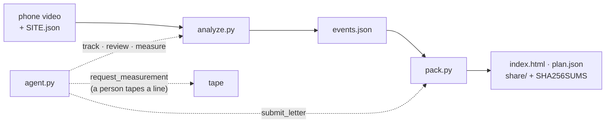

# Crossing Watch: architecture and evaluation

One page for an engineer: how a video becomes a letter, what each of the 47 Python modules does, every
quantitative check with its ground truth and the command that re-runs it, and the data behind each number.
Results and demo: [README](README.md). Full method: [TECHNICAL.md](TECHNICAL.md). Open weights:
[OPEN_WEIGHTS.md](OPEN_WEIGHTS.md). Pass marks written before the runs: [GATES.md](GATES.md).

## From a video to a letter

| Step | Modules | Model or method |
|---|---|---|
| Track | `sam.py`, `crowd.py`, `masks.py` | SAM 3.1 video tracking, one concept per request; in crowds SAM detects on single frames and `crowd.py` keeps the IDs |
| Measure | `road.py`, `pace.py` | a homography from four taped points to road metres; post-encroachment time (PET) and speed; walking pace checks the clock and the calibration |
| Review | `review.py` | Muse Spark, or an open-weights model through `openweights.py`, looks at a crop of each person in a near-miss |
| Hear and hide | `listen.py`, `voice.py`, `render.py` | Muse Wonder times horns; Muse Voice Transcribe finds speech to mute; heads blurred, plates hidden |
| Write and check | `pack.py` | the letter is written from `facts()` only; `unmeasured()`, `mixed()` and `slips()` check every number by code; `judge_problems()` asks Muse Spark and, with `JUDGE_MODEL_URL` set, the tuned Glimmer judge |
| Draw | `fixband.py`, `ailabel.py` | Muse Image draws the fix only inside the band where people crossed; the picture is labelled AI-generated |
| Seal | `seal.py` | sha256 of the video, SHA256SUMS of the published folder; model replies reused by the hash of the request |
| Case agent | `agent.py`, `openagent.py` | Muse Spark or Muse Spark Open, five tools, one per turn; `submit_letter` is refused until the video's metres and a person's tape agree within 15% |

## Code map: 47 modules in 7 groups

| Group | Modules | Lines | Start here |
|---|---|---|---|
| 1. Measure: video to `events.json` | 11 | 2,806 | `analyze.py` |
| 2. Before filming | 2, plus `calibrate.html` | 310 | `filmcheck.py` |
| 3. Evidence page and letter | 11 | 2,928 | `pack.py` |
| 4. Case agent | 3 | 850 | `agent.py` |
| 5. Ground truth and human checks | 9 | 1,280 | `validate_dut.py` |
| 6. Letter judge and open weights | 10 | 2,860 | `judge_v3_score.py` |
| 7. Self-checks | 1 | 5,477 | `test_cw.py` |

**1. Measure** (`python3 analyze.py VIDEO SITE.json`)
- `analyze.py`: the entry point; tracks, measures, reviews and writes `events.json`, most dangerous first.
- `sam.py`: SAM 3.1 video tracking through the Meta Model API, one concept ("person", "car") per request.
- `crowd.py`: crowd mode; SAM finds every person on single frames and a small tracker keeps their IDs.
- `masks.py`: decodes SAM's one_bit masks for drawing (a port of Meta's decoder, SAM License); every measurement stays on boxes.
- `road.py`: pixels to road metres, post-encroachment time and speed; the maths core.
- `pace.py`: people are the clock; the median walking speed checks the video's clock and calibration at once.
- `review.py`: Muse Spark's second look at each near-miss: a person on foot, a rider, or not a person.
- `listen.py`: Muse Wonder listens around each near-miss for horns, brakes and shouts.
- `voice.py`: Muse Voice Transcribe turns spoken notes into text and finds speech in a clip so it can be muted.
- `render.py`: the evidence clips, with tracks drawn, heads blurred and plates hidden.
- `seal.py`: tamper-evident hashes, and model replies reused by the hash of what was sent.

**2. Before filming**
- `calibrate.html`: click the four taped corners (and the tape marks) on a frame; downloads SITE.json.
- `filmcheck.py`: is a clip shot as [FILMING.md](FILMING.md) asks: size, frame rate, HDR, sound, a still view.
- `stabilize.py`: locks a hand-held recording to one reference frame (SIFT and RANSAC; the one module that uses OpenCV and NumPy).

**3. Evidence page and letter** (`python3 pack.py OUT_DIR SITE.json`)
- `pack.py`: the page and the letter; its parts are mapped below.
- `summary.py`: the page's first screen, built only from the page's own pieces.
- `roadmap.py`: the bird's-eye map in road metres: where people crossed, each near-miss's paths, the gap barcode.
- `overlay.py`: the gap clock over each clip and the stopping strip on the worst card.
- `fixband.py`: the band where people cross; Muse Image draws only inside it.
- `ailabel.py`: burns "AI-generated by Muse Image" into any picture made from a Muse Image output.
- `gazette.py`: India's driving regulations, quoted word for word by code, never by a model.
- `passmark.py`: G7's after-fix pass mark (one-sided Fisher exact test), shown before any fix exists.
- `hindi.py`: the Hindi copy, checked to hold exactly the English letter's numbers.
- `openweights.py`: any OpenAI-compatible server as the letter writer or judge: Glimmer on Kaggle, Spark Open on Fireworks.
- `letter_pdf.py`: the printable letter for signing, with its sha256.

**4. Case agent**
- `agent.py`: Muse Spark works the case through five tools (track, review, measure, request_measurement, submit_letter) and pauses for a person's tape measure.
- `openagent.py`: the same turns on an open-weights model (Muse Spark Open on Fireworks).
- `monday.py`: the gate run in one command: filmcheck and a $0 SAM estimate, then the capped paid run.

**5. Ground truth and human checks**
- `validate_sind.py`: our PET and speed against SinD's drone trajectories and the textbook PET; `--oblique` simulates a phone's angle.
- `validate_dut.py`: the whole pipeline on DUT drone clips, scored against the dataset's own trajectories.
- `validate_offline.py`: the DUT score re-run at $0 from cached replies with today's code.
- `validate_gate.py`: G6, each vehicle's speed against two taped lines timed by hand.
- `vehicle_test.py`: does SAM's one concept "vehicle" find what three concepts find.
- `feet_overlap.py`: how often feet sit on a vehicle's box at an angle, from a cached run.
- `blind_set.py`: G5's blind set, the pipeline's near-misses shuffled among decoys for a rater.
- `score_humans.py`: scores G5's raters against the key (agreement and Cohen's kappa).
- `guess.py`: people's speed guesses against the measured speed.

**6. Letter judge and open weights**
- `judge_bench.py`: lies planted one at a time in real letters; scores the code check, Muse Spark and Glimmer.
- `finetune_judge.py`: training rows for the Glimmer judge, from synthetic packs only.
- `natural_edits.py`: an editor model writes each test lie in its own words, so a judge cannot pass by recognising templates.
- `judge_v4.py`, `judge_v5.py`, `judge_v6.py`, `judge_v7.py`: one builder per pre-registered blind test (see "Why the root is flat").
- `judge_compare.py`: the v2 sweep's four tuned judges, Muse Spark and Muse Spark Open on the same 211 prompts.
- `judge_v3_score.py`: re-scores v3 to v6 at $0 from committed files.
- `writers_table.py`: who wrote each letter, where, how long and at what cost, from the run records.

**7. Self-checks**
- `test_cw.py`: 243 offline checks, one function per behaviour, each named as a sentence. One check alone:
  `python3 -c 'import test_cw; test_cw.test_readme_first_screen_fits_a_phone_its_links_resolve_and_one_story_on_the_kaggle_account()'`.
- `test_cw.py` imports 44 of the other 46 modules and `video/split.py`; `gazette.py` is checked through `pack.gazette`,
  and `stabilize.py` (OpenCV) is the one module no check runs.
- `video/split.py` makes the film's split shot; `provenance/` holds each recorded run's own scripts and logs.

### pack.py, by part

| Part | Functions |
|---|---|
| What a letter may quote | `facts`, `headline`, `engineering_lines`, `exact_range`, `poisson_range`, `share_range` |
| Number checks, by code | `unmeasured`, `mixed`, `accusing`, `slips` |
| Writing and judging | `ask_plan`, `model_plan`, `judge_problems`, `read_problems`, `vote`, `open_model_reply` |
| The page | `page`, `top`, `stats`, `event_card`, `map_section`, `letter_section`, `legal_section`, `draw_fix` |
| Sign-off and publishing | `sign`, `is_signed`, `write_plan`, `share`, `verify_folder` |
| Command line | `parse_args`, `main` |

## Why the root is flat

- **Recorded runs import these modules by name.** `provenance/glimmer-judge-lora-v6/kaggle/score_kaggle.py`,
  `provenance/open-gate-2026-11-04/judge_case.py` and `provenance/glimmer-vision-review-2026-11-04/run_review.py` put
  the repository root on `sys.path` and `import pack` or `import review`; the Kaggle notebooks find `pack.py` and copy
  its folder. A flat root keeps every recorded run re-runnable from this tree as it stands.
- **One file per pre-registered test.** `judge_v4.py`, `judge_v5.py` and `judge_v6.py` were each committed once, after
  their test's pre-registration, and never edited (`git log -- judge_v4.py`). Each new test imports the previous
  builders instead of changing them, so every test file rebuilds as it was. `judge_v7.py` builds v7, cancelled before
  any letter ([GATES.md](GATES.md)).
- **Standard library only.** Python 3.11+ and ffmpeg run the pipeline and every check, with nothing to pip-install.
  The optional extras: OpenCV and NumPy for `stabilize.py`, and the tokenizer libraries that `judge_v6.py` and
  `judge_v7.py` load only to count training tokens. `python3 test_cw.py` is the whole setup, and CI runs exactly that
  on every push.

## Evaluation at a glance

Each row gives its ground truth and the command that re-runs it. Rows marked $0 need no key; the judge re-scores take
about 0.1 s each. SinD needs its public download first; DUT and our paid SAM cache are not public, so that row is read
from its record.

| What is measured | Ground truth | Result | Re-run | Cost |
|---|---|---|---|---|
| Road metres on our gate (G2) | a tape measure on line A to B, a line the calibration never used | video 15.0 m, tape 15 m; pass mark ±15%, written 28 Oct | `python3 -c 'import json,agent; print(round(agent.check_distance(json.load(open("sites/gate.json"))),1))'` prints 15.0 | $0 |
| PET and speed maths | SinD drone trajectories; the textbook conflict-zone PET (Allen et al. 1978) | speed error 0.24 km/h mean, 0.91 km/h at the 95th percentile; PET within 0.5 s on 53 of 66 conflicts | `python3 validate_sind.py data/sind` | $0 after the SinD download |
| The whole pipeline, SAM 3.1 to near-misses | DUT drone trajectories of a campus crosswalk | 47 of 52 near-misses after Muse Spark's review (50 of 52 by geometry); speed error 0.16 km/h mean, 0.55 km/h at the 95th percentile | `python3 validate_offline.py DUT_REPO out/dut-15s out/dut-vcrowd` | not public (DUT has no licence; `out/` is our paid SAM cache): read the [record](GATES.md#accuracy-fixes-merged-re-scored-at-0-fri-30-oct-2026) |
| Letter checks against planted lies | 23 lies planted by code in real letters, and 8 clean controls | code alone 4 of 23; Muse Spark 21 of 23, 0 of 8 false alarms | `python3 judge_bench.py --public` | $0, replies cached |
| Tuned Glimmer judge against Muse Spark Open, three blind tests (v4, v5, v6) | planted errors in synthetic letters; each protocol committed before its run, labels frozen before any tuned reply was read | wins all three: p 0.005, 0.029, 0.0006 (exact test on the rows where exactly one judge is right) | `python3 judge_v3_score.py v4`, then `v5` and `v6` | $0 |
| The same judge on Kaggle's free 2 x T4 | v6's frozen labels, 1,501 rows | 1,435 right; 81 vs 49 against Muse Spark Open, p 0.006; the same verdict as the Fireworks deployment on 1,492 | `python3 provenance/glimmer-judge-lora-v6/kaggle/score_kaggle.py provenance/glimmer-judge-lora-v6/kaggle/predictions_kaggle.jsonl` | $0 |
| What the LoRA adds | base Glimmer 30B on the same 1,210 rows and labels, pre-registered | base 781 right, tuned 1,163; 402 vs 20 head to head | `python3 provenance/glimmer-judge-lora-v6/base/score_base.py provenance/glimmer-judge-lora-v6/base/predictions_base.jsonl` | $0 |
| The same judge on public data | SummEdits (Laban et al. 2023): document and summary pairs labelled by people, 10 domains, 1,200 fresh rows; pre-registered | 1,008 right vs Muse Spark Open 924; 164 vs 80, p < 0.0001; ahead in all 10 domains; base Glimmer with 8,192 tokens 748 (369 vs 109 to the tuned judge); a first test of 400: 340 vs 322, p 0.060 | `cd provenance/summedits-2026-11-05 && python3 score_rep.py rep.jsonl rep-tuned.jsonl rep-spark-open.jsonl` | $0 |
| Glimmer 30B as the crop reviewer | Muse Spark's keep/remove calls on our gate's 32 reviewed people; the rule written before any call | the same call on 32 of 32 | `python3 provenance/glimmer-vision-review-2026-11-04/score.py` | $0 |
| The whole gate case on open weights | the hosted Muse Spark run on the same footage | the same 5 near-misses and 51 people; the letter passed the code check on the first try | [run record](provenance/open-gate-2026-11-04/README.md) | read |
| Self-checks | the expected values written into each check | 243 pass | `python3 test_cw.py` | $0, under a minute |

## Data behind each number

| Data | Kind | Numbers it backs | In this repository |
|---|---|---|---|
| Our college gate, 8.6 minutes, Mon 2 Nov 2026 | real footage, one phone, filmed with the college's permission | 75 alarms to 5 near-misses; 0.0 s and 0.42 m; 51 people, 55 vehicles | blurred clips and the evidence page in `docs/`; the raw video stays on the laptop that ran it |
| A tape measure on our gate's line A to B | real, measured by hand | G2: video 15.0 m, tape 15 m | the agent's log, `provenance/gate-agent-2026-11-02/` |
| DUT (Yang et al., IEEE IV 2019) | real drone video of a campus crosswalk, with the dataset's own trajectories | 47 of 52; speed error 0.16 km/h | our scores only; DUT is cited and not redistributed |
| SinD public sample (Xu et al., IEEE ITSC 2022) | real drone trajectories, Tianjin | speed error 0.24 km/h; PET within 0.5 s on 53 of 66 | our scores only; download it from its repository |
| A news CCTV clip of schoolchildren | real public footage | G1, tracking | the site file `sites/kids-cctv.json`; the clip is linked, not copied |
| `sample/` | synthetic tracks, written so the page builds offline with no key | the offline demo and the public judge bench's letters | yes |
| Judge training and test letters, v2 to v6 | synthetic packs with new numbers and made-up road names; letters written by Muse Spark Open and Muse Spark; errors planted by code or by an editor model | the three blind-test wins; base 781 to tuned 1,163 | `kaggle/glimmer-judge-train-*.jsonl`, `provenance/glimmer-judge-lora-v*/` |
| The fix picture | Muse Image's drawing, kept by code only inside the strip where people were measured crossing; every other pixel is the real, blurred street; labelled AI-generated | an illustration of the requested fix; it backs no number | `docs/evidence/street-band.svg` (evidence page), `docs/readme/fix-band.jpg` (README copy) |
