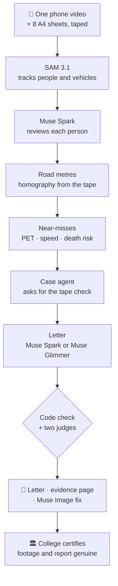

<div align="center">

<sub><b>META GLOBAL AI DEVELOPER HACKATHON 2026 · INDIE TRACK · SOLO ENTRY · BHOPAL, INDIA</b></sub>

# 🚸 Crossing Watch

### One phone video in. Proof the road authority can act on, out.
**सड़क का ख़तरा · नाप के · सबूत के साथ**

**English** · [हिंदी](https://crossingwatch.xyz/?lang=hi) · every page of the website has a हिंदी / English switch

<a href="docs/evidence/event1.mp4"></a>
<p><b>Real footage from our college gate, faces blurred.</b> A person (cyan) and a motorcycle (red) reach the same spot at the same instant: post-encroachment time <b>0.0 s</b>, motorcycle at <b>18.7 km/h</b>.</p>

<b>▶ Demo video (2:52): GATE-TBD</b>

Near-miss evidence for a dangerous school or college crossing. **Meta SAM 3.1** tracks every person and vehicle,<br>
code measures each near-miss in road metres, and **Muse Spark** writes a letter whose every number is checked.

**Six Meta models:** SAM 3.1 · Muse Spark · Muse Image · Muse Wonder · Muse Glimmer 30B (open weights, fine-tuned by us) · Muse Spark Open (open weights) · [what each one does](#-six-meta-models-each-doing-real-work)

<a href="https://crossingwatch.xyz"></a> <a href="#-demo"></a> <a href="https://crossingwatch.xyz/manual/"></a> <a href="https://crossingwatch.xyz/app/"></a> <a href="https://crossingwatch.xyz/explorer/"></a> <a href="JUDGES.md"></a>

 <a href="OPEN_WEIGHTS.md"></a> <a href="TECHNICAL.md#end-to-end-against-ground-truth-dut"></a>

<table>
<tr>
<td align="center" width="33%">

### 📱 1. Film
One phone over the road, a tape measure and 4 bright markers (A4 paper works).

</td>
<td align="center" width="33%">

### 📏 2. Measure
SAM 3.1 tracks everyone; code turns pixels into road metres and finds every near-miss.

</td>
<td align="center" width="33%">

### 📄 3. Prove
Muse Spark writes the letter; code and two judges check it; the college certifies the report is genuine.

</td>
</tr>
</table>

<i>Every line of code, every measurement and every image here was made during the hackathon, from 28 Oct 2026 ([declarations](#declarations)).</i>

</div>

---

## 📑 Contents

[The problem](#-the-problem) · [Results](#-results-on-our-gate) · [Demo](#-demo) · [Try it in your browser](#-try-it-in-your-browser) · [Pipeline](#-pipeline) · [Six Meta models](#-six-meta-models-each-doing-real-work) · [How we know it's right](#-how-we-know-its-right) · [Screens](#-screens) · [Run it locally](#-run-it-locally) · [Privacy and cost](#-privacy-and-cost) · [Deep dive](#-deep-dive) · [Declarations](#declarations)

## 🚨 The problem

Outside schools and colleges everywhere, students cross between bikes, cars and buses every day. Road crashes kill about
**1.19 million people a year** and are the **leading cause of death for people aged 5 to 29** ([WHO, Global status report
on road safety 2023](https://www.who.int/publications/i/item/9789240086517)). Every school wants a speed breaker or a zebra
crossing at its gate, and only the road authority can build one. The authority asks for proof. **Crossing Watch turns one
phone video into that proof:** measured near-misses, blurred clips, and a letter the head of the college can sign.

## 📊 Results on our gate

<i>LNCT Excellence main gate, Bhopal (service road below NH 146) · Mon 2 Nov 2026, afternoon dismissal · one phone, 8.3 m up</i>

| Measured | Value |
|---|---|
| ⏱️ Video | **8.6 minutes** on a taped 15 m stretch |
| 🚶 Pedestrian crossings | **80**, by **51** people |
| 🏍️ Moving vehicles | **55** · 85th-percentile speed **23.2 km/h** |
| 🔴 Serious near-misses (PET < 1.5 s) | **2**: 0.0 s at 18.7 km/h, 0.9 s at 18.3 km/h |
| 🟠 Close passes (1.5 to 3.0 s) | **3** |
| 📏 Tape check (never used to calibrate) | video **15.0 m** · tape **15 m** |
| 🏛️ The college | certified in writing (3 Nov 2026): filmed at its gate with permission, **the report is genuine** |
| 📄 The ask | a **painted zebra crossing** (no hump: college buses use this road) and **"College Zone 20 km/h"** signs |


<p><b>The 0.0 s near-miss in one picture.</b> SAM 3.1 tracks the motorcycle (red) and the person (cyan); one copy every 0.5 s, so wider spacing means faster. Faces and plates blurred.</p>

## 🎬 Demo

GATE-TBD: the 2:52 demo video link. It opens on our real near-miss (0.0 s), then the problem, the run, the checks, the open models and the fix.

## 🧪 Try it in your browser

No install, no key. Every page works in a browser and has a हिंदी / English switch.

| Page | What you can do |
|---|---|
| 🛠️ **[App](https://crossingwatch.xyz/app/)** | Crossing Watch in 4 steps. Step 1 is the real road-marking tool: press **Try it with our gate** and the 4 corners of our 8 m × 7 m rectangle turn pixels into metres. Steps 2 and 3 replay our real run and the agent asking for a tape measure. |
| 🔎 **[Explorer](https://crossingwatch.xyz/explorer/)** | All 75 near-miss candidates from our gate. Move the threshold, switch Muse Spark's review off and on, replay any near-miss on the road map, play its blurred clip. |
| 📘 **[Manual](https://crossingwatch.xyz/manual/)** | 7 simple steps to measure the road outside your own school, with the tape plan and a printable field sheet. |
| 📄 **[Evidence dashboard](https://crossingwatch.xyz/evidence/)** | The report the tool made for our gate: clips, map, the Muse Image fix and the letter. |

<table>
<tr>
<td width="50%"><a href="https://crossingwatch.xyz/explorer/"></a><br><i><b>Explorer.</b> Watch the tool decide.</i></td>
<td width="50%"><a href="https://crossingwatch.xyz/app/"></a><br><i><b>App.</b> The agent stops and asks for a tape measure.</i></td>
</tr>
</table>

## 🧭 Pipeline



## 🧠 Six Meta models, each doing real work

| Model | Job in Crossing Watch | Proof |
|---|---|---|
| **SAM 3.1** | Tracks every person and vehicle, frame by frame | 47 of 52 near-misses vs drone truth; speed error 0.16 km/h mean ([DUT](TECHNICAL.md#end-to-end-against-ground-truth-dut)) |
| **Muse Spark** | Reviews each person, runs the case agent, writes the letter, judges it | flagged 24 of 24 planted lies ([bench](TECHNICAL.md#checking-the-checks)) |
| **Muse Image** | Draws the fix onto the real, blurred street, only where people crossed | [how](TECHNICAL.md#how-it-works) |
| **Muse Wonder** | Listens around each near-miss for horns, brakes and shouts | heard horns around 4 of the 5 near-misses at our gate |
| **Muse Glimmer 30B** · open weights | Wrote a full letter for our real gate on a free Kaggle GPU; our LoRA fine-tune judges letters | letter in **276 s, first try**; tuned judge **wins 3 pre-registered blind tests** vs Muse Spark Open ([one page](OPEN_WEIGHTS.md)) |
| **Muse Spark Open** · open weights | Second judge of our real letter | 6 of 6 reads of our real letter: no unsupported claim ([record](provenance/spark-open-fireworks-gate.json)) |

<details>
<summary><b>Every model's numbers in full</b></summary>

- **SAM 3.1** tracks people and vehicles. Against DUT's top-down drone ground truth: 47 of 52 conflicts found after Muse Spark's review (50 of 52 by geometry alone; crowd mode); speed error 0.16 km/h mean, 0.55 km/h at the 95th percentile (vehicle crowd mode). [DUT](TECHNICAL.md#end-to-end-against-ground-truth-dut), [30 Oct re-score](GATES.md#accuracy-fixes-merged-re-scored-at-0-fri-30-oct-2026)
- **Muse Spark** reviews each person, writes the fix and the letter, and runs the [case agent](TECHNICAL.md#case-agent-it-stops-to-ask-for-a-tape-measure), which stops to ask for a tape measure (on our gate: "Video 15.0 m, tape 15 m, 0% off: proven"). As judge it flagged 24 of 24 planted lies and only 1 of 8 clean letters (code alone: 4 of 24). [bench](TECHNICAL.md#checking-the-checks)
- **Muse Image** draws the fix only inside the strip where people were measured crossing; every other pixel stays the real, blurred street (the whole photo when no path was measured). Nothing measured. [how](TECHNICAL.md#how-it-works)
- **Muse Wonder** listens around each near-miss for horns, brakes and shouts. At our gate it heard horns around 4 of the 5 near-misses, each one timed on its card ("horn 1.0 s after") on the [evidence page](https://crossingwatch.xyz/evidence/).
- **Muse Glimmer 30B (open weights)**, self-hosted on Kaggle 2 x T4 from sha256-checked weights, wrote **a letter for our real gate in 276 s on the first try**, every number passing the code check ([letter](kaggle/glimmer-gate-letter.txt), [record](kaggle/glimmer-gate-provenance.json); written from our first notes, which asked for a raised crossing; the letter for the authority is Muse Spark's: painted zebra, no hump). Our free LoRA fine-tune of Glimmer **beats Muse Spark Open in three pre-registered blind tests** (p 0.005, 0.029, 0.0006); served on a Fireworks H200 it gives the same verdict on 1,499 of 1,501 rows, at about a quarter of Muse Spark's cost. [open weights, one page](OPEN_WEIGHTS.md)
- **Muse Spark Open (open weights)** on Fireworks wrote the synthetic sample's letter in one try, 55.5 s, and is the second judge of our crossing's letter. [record](provenance/spark-open-fireworks-sample.json)


</details>

## 🔬 How we know it's right

| | Check | Result | Proof |
|---|---|---|---|
| 🛰️ | Drone ground truth (DUT, top-down) | **47 of 52** near-misses found after Muse Spark's review; speed error **0.16 km/h** mean | [method](TECHNICAL.md#end-to-end-against-ground-truth-dut) |
| 📏 | Tape check on our gate, a line the maths never used | video **15.0 m**, tape **15 m**, 0% off | [the agent](TECHNICAL.md#case-agent-it-stops-to-ask-for-a-tape-measure) |
| 🧮 | Near-miss maths on public drone data (SinD) | speed error **0.24 km/h** mean | [validation](TECHNICAL.md#validation-on-ground-truth-trajectories) |
| 🕵️ | The letter: planted false numbers and claims | Muse Spark flagged **24 of 24**; code checks every number | [bench](TECHNICAL.md#checking-the-checks) |
| 🔓 | Open weights | tuned Glimmer judge wins **3** pre-registered blind tests over Muse Spark Open; Muse Spark Open read our letter **6 of 6** times, no unsupported claim | [one page](OPEN_WEIGHTS.md) |
| 📋 | Pass marks written before the runs | **G1 to G4 passed**: news CCTV, our gate's tape (15.0 m vs 15 m), DUT drone truth, our footage end to end | [GATES](GATES.md#verdict-now) |
| ✅ | Self-checks | `python3 test_cw.py`, offline, in under a minute | [every claim](TECHNICAL.md#check-it-yourself) |

## 📸 Screens

<table>
<tr>
<td width="33%"><br><i><b>The gate.</b> Real photo, the road we measured.</i></td>
<td width="33%"><a href="docs/story/06-letter.jpg"></a><br><i><b>The letter.</b> To the road authority, every number code-checked.</i></td>
<td width="33%"><br><i><b>The fix, drawn by Muse Image.</b> What the letter asks for. AI-generated: the people are not real.</i></td>
</tr>
</table>

## 🚀 Run it locally

Needs Python 3.11+ and ffmpeg; no key, no video. With `MODEL_API_KEY` or `LETTER_MODEL_URL` set, the sample also gets the fix and the letter.
```
python3 test_cw.py                        # self-checks, under a minute
python3 pack.py sample sample/site.json   # the synthetic sample (made-up tracks) -> sample/index.html
open sample/index.html                    # macOS; elsewhere open the file in a browser
```

## 🔒 Privacy and cost

- 🙈 Every tracked face and number plate is blurred on every published frame. The raw video stays on the laptop that ran it, apart from the calls to Meta's API, in Standard mode (not used to train models).
- 💸 About **$12** of SAM for our 8.6-minute gate video at Meta's list prices, plus about **$0.02** for the agent, against about **C$5,000** an intersection for a funded near-miss study ([Scale](TECHNICAL.md#scale)). `--budget` is a hard cap.
- 🔑 Keys stay in `.env`, never in the repo.
- 🏫 Filmed with the college's permission; on 3 Nov 2026 the college certified the report genuine.

## 📚 Deep dive

Everything else is in **[TECHNICAL.md](TECHNICAL.md)**:

- **[Open weights, one page](OPEN_WEIGHTS.md)**: Glimmer's gate letter, our LoRA judge and its three blind wins
- **[Case agent](TECHNICAL.md#case-agent-it-stops-to-ask-for-a-tape-measure)**: the agent that stops to ask for a tape measure
- **[Check it yourself](TECHNICAL.md#check-it-yourself)**: every claim, the command that re-checks it, and whether a judge can do it for $0
- **[Files](TECHNICAL.md#files)**: what each script does
- **[How it works](TECHNICAL.md#how-it-works)**: every step: the model or method and its file
- **[Run](TECHNICAL.md#run)**: the commands, notes and sign-off, the Hindi copy, what gets published, Standard mode, caching
- **[Checking the checks](TECHNICAL.md#checking-the-checks)**: the planted-lies bench and the blind check
- **[Validation on ground-truth trajectories](TECHNICAL.md#validation-on-ground-truth-trajectories)**: SinD, the phone-angle simulation and DUT end to end
- **[Scale](TECHNICAL.md#scale)**: cost against a funded near-miss study
- **[Limits, stated](TECHNICAL.md#limits-stated)**: what the tool cannot do
- **[Related work](TECHNICAL.md#related-work)**: near-miss studies in India and elsewhere
- **[Sources](TECHNICAL.md#sources)**: every paper, standard and order we cite

## Declarations

Solo entry by Ayush Kumar, built with Claude Code as a coding assistant. All work here was done during the hackathon,
from 28 Oct 2026; the one ported piece is the mask decoder below. The Kaggle notebook was run by the author. The gate letter's run
(`kaggle/glimmer-gate.ipynb`) was on the author's own Kaggle account.

- **Licences.** `masks.py` ports the one_bit mask decoder from Meta's meta-sam-parser (`_mask_codec.py`, Copyright (c)
  Meta Platforms, Inc. and affiliates) under its SAM License, in `LICENSES/SAM-License.txt`; everything else is MIT
  (`LICENSE`). The letter's check-then-retry, reject-with-notes and one-tool-per-turn agent loop follow the shape of
  Meta's legal-agent workshop (github.com/meta-models/legal-agent-workshop); no code was copied from it.
- **What runs.** Python standard library only, plus ffmpeg as a command-line tool (a GPL build with libx264, not
  bundled) and Chrome or any Chromium for the demo's hero shot (`video/split.py`). Inside the Kaggle notebook:
  llama.cpp `b11976` (MIT), huggingface_hub (Apache-2.0) and the Muse Glimmer 30B GGUF weights (Apache-2.0, Hugging
  Face revision `b44f1072`). Built with Muse Spark Open: its open weights are used as served by Fireworks under Meta's Muse Model License, and
  our Glimmer judge adapter is trained partly on letters Spark Open wrote, so it follows that licence too. Models run as
  services: the Meta Model API, Fireworks for Muse Spark Open, Kaggle's
  2 x T4 for Glimmer.
- **Datasets, none included.** SinD (github.com/SOTIF-AVLab/SinD; non-commercial, its public sample used only for
  validation; Xu Y. et al., IEEE ITSC 2022, doi:10.1109/ITSC55140.2022.9921959, v1). DUT
  (github.com/dongfang-steven-yang/vci-dataset-dut; no licence given, used only for internal testing; Yang D. et al.,
  IEEE IV 2019, arXiv:1902.00487). Two YouTube clips used only for local testing: the schoolchildren CCTV clip
  (https://youtu.be/9YqdnG5Jxnw) and the Indian time-lapse (https://youtu.be/_l99w_CKwCU).
- **AI assistance.** Code and docs were written with an AI coding assistant, and the reviews named in `GATES.md` were
  AI-assisted; every model call in the product is to a Meta model.
