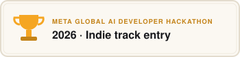
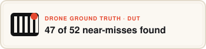
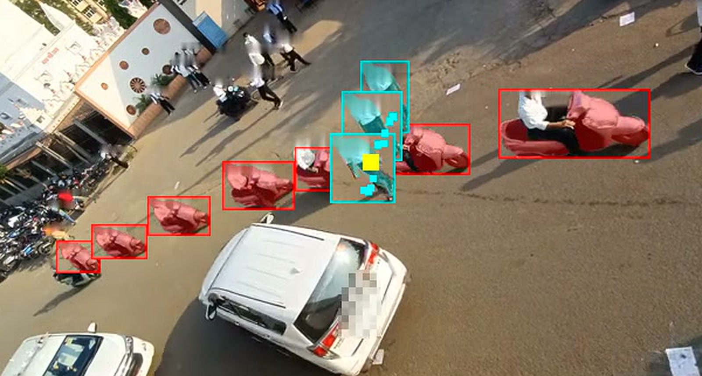
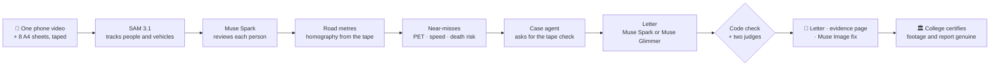
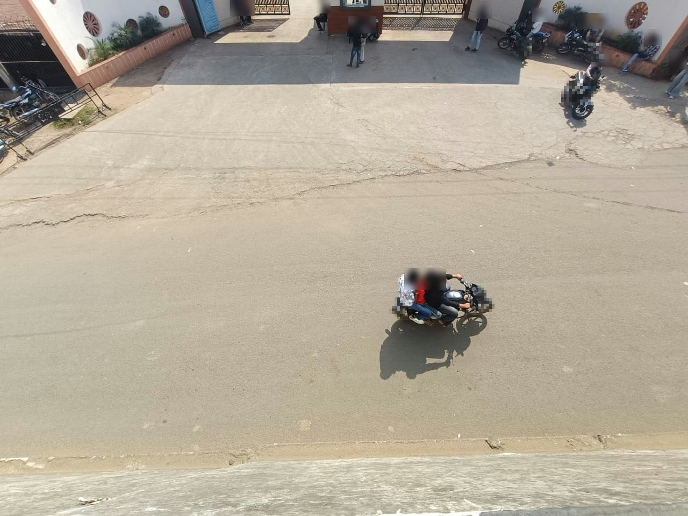
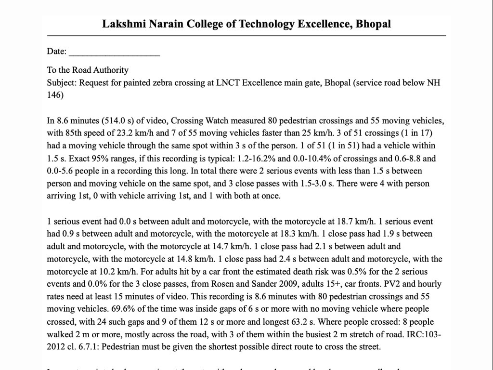
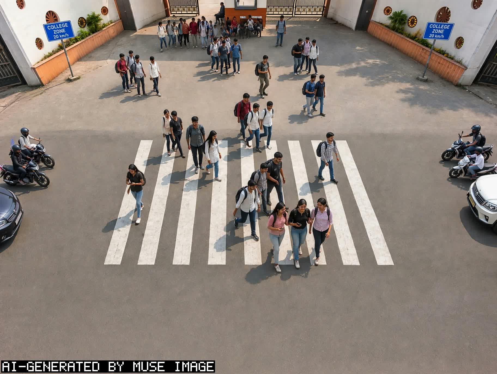

<div align="center">

<sub><b>META GLOBAL AI DEVELOPER HACKATHON 2026 · INDIE TRACK · SOLO ENTRY · BHOPAL, INDIA</b></sub>

# 🚸 Crossing Watch

### One phone video in. Proof the road authority can act on, out.
**सड़क का ख़तरा · नाप के · सबूत के साथ**

 <a href="OPEN_WEIGHTS.md"></a> <a href="#end-to-end-against-ground-truth-dut"></a>

**English** · [हिंदी (website)](https://crossingwatch.xyz/?lang=hi)

<a href="https://crossingwatch.xyz"></a> <a href="#-demo"></a> <a href="JUDGES.md"></a> <a href="OPEN_WEIGHTS.md"></a>

   

 

     

Near-miss evidence for a dangerous school or college crossing. **Meta SAM 3.1** tracks every person and vehicle,<br>
code measures each near-miss in road metres, and **Muse Spark** writes a letter whose every number is checked.

<table>
<tr>
<td align="center" width="33%">

### 📱 1. Film
One phone over the road, a tape measure and 8 sheets of A4.

</td>
<td align="center" width="33%">

### 📏 2. Measure
SAM 3.1 tracks everyone; code turns pixels into road metres and finds every near-miss.

</td>
<td align="center" width="33%">

### 📄 3. Prove
Muse Spark writes the letter; code and two judges check it; the college certifies it is genuine.

</td>
</tr>
</table>


<p><sub><b>Real footage from our college gate, faces blurred.</b> A person (cyan) and a motorcycle (red) reach the same spot at the same instant: post-encroachment time <b>0.0 s</b>, motorcycle at <b>18.7 km/h</b>.</sub></p>

<br><br>

<sub>Every line of code, every measurement and every image here was made during the hackathon, from 28 Oct 2026 ([declarations](#declarations)).</sub>

</div>

---

## 📑 Contents

[The problem](#-the-problem) · [Results on our gate](#-results-on-our-gate) · [Demo](#-demo) · [Pipeline](#-pipeline) · [Six Meta models](#-six-meta-models-each-doing-real-work) · [Screens](#-screens) · [Try it in one minute](#-try-it-in-one-minute) · [Check it yourself](#check-it-yourself) · [How it works](#how-it-works) · [Open weights](#open-weights-muse-glimmer-writes-the-letter) · [Case agent](#case-agent-it-stops-to-ask-for-a-tape-measure) · [Checking the checks](#checking-the-checks) · [Ground truth](#validation-on-ground-truth-trajectories) · [Limits](#limits-stated) · [Declarations](#declarations)

## 🚨 The problem

Outside schools and colleges everywhere, students cross between bikes, cars and buses every day. Road crashes kill about
**1.19 million people a year** and are the **leading cause of death for people aged 5 to 29** ([WHO, Global status report
on road safety 2023](https://www.who.int/publications/i/item/9789240086517)). Every school wants a speed breaker or a zebra
crossing at its gate, and only the road authority can build one. The authority asks for proof. **Crossing Watch turns one
phone video into that proof:** measured near-misses, blurred clips, and a letter the head of the college can sign.

## 📊 Results on our gate

<sub>LNCT Excellence main gate, Bhopal · Mon 2 Nov 2026, afternoon dismissal · one phone, 8.3 m up, over the highway</sub>

| Measured | Value |
|---|---|
| ⏱️ Video | **8.6 minutes** on a taped 15 m stretch |
| 🚶 Pedestrian crossings | **80** |
| 🏍️ Moving vehicles | **55** · 85th-percentile speed **23.2 km/h** |
| 🔴 Serious near-misses (PET < 1.5 s) | **2**: 0.0 s at 18.7 km/h, 0.9 s at 18.3 km/h |
| 🟠 Close passes (1.5 to 3.0 s) | **3** |
| 📏 Tape check (never used to calibrate) | video **15.0 m** · tape **15 m** |
| 🛰️ Drone ground truth (DUT) | **47 of 52** near-misses found after Muse Spark's review |
| 🏛️ The college | certified in writing (3 Nov 2026): filmed at its gate with permission, **the report is genuine** |
| 📄 The ask | a **painted zebra crossing** (no hump: college buses use this road) and **"College Zone 20 km/h"** signs |

## 🎬 Demo

GATE-TBD: the demo video link (2:40) and its thumbnail.

## 🧭 Pipeline



## 🧠 Six Meta models, each doing real work

| Model | Job in Crossing Watch | Proof |
|---|---|---|
| **SAM 3.1** | Tracks every person and vehicle, frame by frame | 47 of 52 near-misses vs drone truth; speed error 0.16 km/h mean ([DUT](#end-to-end-against-ground-truth-dut)) |
| **Muse Spark** | Reviews each person, runs the case agent, writes the letter, judges it | flagged 24 of 24 planted lies ([bench](#checking-the-checks)) |
| **Muse Image** | Draws the fix onto the real, blurred street, only where people crossed | [how](#how-it-works) |
| **Muse Wonder** | Listens around each near-miss for horns, brakes and shouts | heard brakes on our college clip, spectrogram agrees |
| **Muse Glimmer 30B** · open weights | Wrote our real gate's letter on a free Kaggle GPU; our LoRA fine-tune judges letters | letter in **276 s, first try**; tuned judge **wins 3 pre-registered blind tests** vs Muse Spark Open ([one page](OPEN_WEIGHTS.md)) |
| **Muse Spark Open** · open weights | Second judge of our real letter | 6 of 6 reads of our real letter: no unsupported claim ([record](provenance/spark-open-fireworks-gate.json)) |

<details>
<summary><b>Every model's numbers in full</b></summary>

- **SAM 3.1** tracks people and vehicles. Against DUT's top-down drone ground truth: 47 of 52 conflicts found after Muse Spark's review (50 of 52 by geometry alone; crowd mode); speed error 0.16 km/h mean, 0.55 km/h at the 95th percentile (vehicle crowd mode). [DUT](#end-to-end-against-ground-truth-dut), [30 Oct re-score](GATES.md#accuracy-fixes-merged-re-scored-at-0-fri-30-oct-2026)
- **Muse Spark** reviews each person (after it: 48 of 52 in vehicle crowd mode, 1 fewer than the geometry's 49; 47 of 52 in crowd mode, 3 fewer than the geometry's 50; its "unclear keeps the person" and "a lone walker overrules not a person" rules were set after seeing DUT cases), writes the fix and the letter, and as judge flagged 24 of 24 planted lies and 1 of 8 clean letters (code alone: 4 of 24); a Muse judge is not independent of Muse letters. It also runs the [case agent](#case-agent-it-stops-to-ask-for-a-tape-measure), which stops to ask for a tape measure; recorded on our gate ("Video 15.0 m, tape 15 m, 0% off: proven") and on Spark Open with the sample. [bench](#checking-the-checks)
- **Muse Image** draws the fix only inside the strip where people were measured crossing; every other pixel stays the real, blurred street (the whole photo when no path was measured). Nothing measured. [how](#how-it-works)
- **Muse Wonder** listens around each near-miss for horns, brakes and shouts. On our college clip it heard brakes, which a spectrogram corroborates; not ground truth. [GATES](GATES.md#status-update-second-pass-written-before-the-first-commit-28-oct-1919-ist)
- **Muse Glimmer 30B (open weights)**, self-hosted on Kaggle 2 x T4 from sha256-checked weights, wrote **our real gate's letter in 276 s on the first try**, every number passing the code check ([letter](kaggle/glimmer-gate-letter.txt); written from our first notes, which asked for a raised crossing; the letter that goes out is Muse Spark's, painted, no hump). Our free LoRA fine-tune of Glimmer **beats Muse Spark Open in three pre-registered blind tests** (p 0.005, 0.029, 0.0006) and, with our code check, beats Muse Spark on model-written slips (p 0.027); served on a Fireworks H200 it gives the same verdict on 1,499 of 1,501 rows; overall Muse Spark stays ahead; about a quarter of Spark's cost. [record](<removed-run-record>), [open weights, one page](OPEN_WEIGHTS.md)
- **Muse Spark Open (open weights)** on Fireworks wrote the synthetic sample's letter in one try, 55.5 s, and is the second judge of our crossing's letter. [record](provenance/spark-open-fireworks-sample.json)


**Our crossing** (LNCT Excellence main gate, Bhopal, Mon 2 Nov 2026 dismissal, filmed 8.3 m up from the highway): in 8.6 minutes on the taped 15 m stretch, 80 pedestrian crossings among 55 moving vehicles; 2 serious near-misses, one with a person and a motorcycle on the same spot at the same instant, and 3 close passes. The video read the held-out tape line as 15.0 m; the tape says 15 m. Letter by Muse Spark, checked by Muse Spark and Muse Spark Open; the college certified in writing on 3 Nov 2026 that the footage was filmed at its gate with permission and that the report is genuine (signed by the head of department; shown to judges on request).
**Gates**, [pre-registered](GATES.md#verdict-now): G1 passed (news CCTV); G2 passed on our gate (15.0 m vs 15 m taped); G3 passed on DUT ground truth; G4 passed (our footage, end to end); G5, G6 and G8 not run yet; G7's mark is written.


</details>

## 📸 Screens

<table>
<tr>
<td width="33%"><br><sub><b>The gate.</b> Real photo, the road we measured.</sub></td>
<td width="33%"><a href="docs/story/06-letter.jpg"></a><br><sub><b>The letter.</b> To the road authority, every number code-checked.</sub></td>
<td width="33%"><br><sub><b>The fix.</b> Muse Image draws what the letter asks for.</sub></td>
</tr>
</table>

## 🚀 Try it in one minute

No key and no video needed (Python 3.11+ and ffmpeg; the fix and the letter need `MODEL_API_KEY` or `LETTER_MODEL_URL`):
```
python3 test_cw.py                        # self-checks, under a minute (Python 3.11+, ffmpeg)
python3 pack.py sample sample/site.json   # the synthetic sample (made-up tracks) -> sample/index.html
open sample/index.html                    # macOS; elsewhere open the file in a browser
```

## Check it yourself

| Claim | Command | Public file | At $0 by a judge? |
|---|---|---|---|
| The self-checks pass (exit 0; its error-looking lines come from deliberate failure-path tests) | `python3 test_cw.py` | this repo | yes |
| The page builds offline from a synthetic sample | `python3 pack.py sample sample/site.json` | `sample/` | yes |
| Our crossing's headline and clips | open the evidence page | `docs/` (GitHub Pages), release zip | yes, read |
| Every published file is unchanged | `shasum -a 256 -c SHA256SUMS` or `python3 pack.py --verify sample/share` (the sample; the gate's folder after Mon 2 Nov) | `sample/share/SHA256SUMS` | yes |
| Near-miss maths: speed error 0.24 / 0.91 km/h, 37 of 63 crossings within 3 s (SinD) | `python3 validate_sind.py data/sind` | SinD public sample (github.com/SOTIF-AVLab/SinD; download it; non-commercial) | yes, after the download |
| SAM 3.1 end to end: 47 of 52 after Muse Spark's review (50 of 52 by geometry alone), crowd mode; 48 of 52, vehicle crowd mode; speed 0.16 / 0.55 km/h (DUT, top-down) | `python3 validate_offline.py DUT_REPO out/dut-15s out/dut-vcrowd` | not public: DUT has no licence and `out/` is our paid cache; run recorded in [GATES.md](GATES.md#accuracy-fixes-merged-re-scored-at-0-fri-30-oct-2026) | no: read the record |
| Public judge bench: code 4 of 23, Muse Spark 21 of 23 and 0 of 8 (its replies cached) | `python3 judge_bench.py --public` | `kaggle/judge-bench-public.json` | yes, $0 |
| Muse Glimmer 30B wrote the sample's letter on Kaggle 2 x T4 (313 s, 2 tries) and judged 24 of 24 / 6 of 8 | re-run the public notebook, GATE-TBD | `<removed-run-record>`, `<removed-run-record>`, `<removed-run-record>` | yes, on Kaggle's free GPUs; without our DUT-derived bench file it judges Glimmer's letter only (12 lies, 4 controls) |
| Muse Spark Open wrote the sample's letter on Fireworks in 55.5 s, one try | `LETTER_MODEL_URL=https://api.fireworks.ai/inference/v1 LETTER_MODEL=accounts/fireworks/models/muse-spark-open python3 pack.py sample sample/site.json` | `provenance/spark-open-fireworks-sample.json` | yes, read; a re-run needs a Fireworks key |

## Files

- **Run:** `analyze.py` (video to events.json) with `sam.py`, `crowd.py`, `road.py`, `pace.py`, `review.py`,
  `listen.py`, `render.py`, `masks.py` and `seal.py`; before filming, `calibrate.html` and `filmcheck.py`.
- **Page and letter:** `pack.py` with `summary.py`, `roadmap.py`, `overlay.py`, `fixband.py`, `ailabel.py`,
  `openweights.py`, `passmark.py` and `gazette.py`.
- **Case agent:** `agent.py`.
- **Checks:** `test_cw.py`; `validate_sind.py`, `validate_dut.py` and `validate_offline.py` (ground truth);
  `validate_gate.py` (G6, G8); `blind_set.py` and `score_humans.py` (G5); `judge_bench.py`; `vehicle_test.py`;
  `feet_overlap.py` (feet on a vehicle's box, at an angle).
- **Video and X:** `video/split.py` (the hero shot); `guess.py` (X replies' speed guesses against the measured speed).
- **Docs and records:** `FILMING.md`, `GATES.md`, `sites/`, `sample/`, `kaggle/`, `provenance/`, `LICENSES/`.

## How it works

| Step | Model or method | File |
|---|---|---|
| Track every pedestrian and vehicle through the video | **SAM 3.1** (one concept per request: person, car, motorcycle, auto rickshaw...); in crowds, SAM image detection 5 times a second plus our tracker | `sam.py`, `crowd.py` |
| Pixels to metres on the road | 4-point homography from a rectangle marked on the road | `road.py`, `calibrate.html` |
| Clean the tracks | Drop riders inside vehicle boxes and, from a phone at an angle, a person's frames whose feet sit on a vehicle's box, split tracks where the ID jumps, ignore static objects, cut-off boxes and teleport speeds | `road.py` |
| Near-miss | Post-encroachment time (PET) under 1.5 s, within 1 m, vehicle over 10 km/h (why 1.5 s: Sources) | `road.py` |
| Severity | Adult death risk at that speed, Rosén & Sander (2009); replay under 30 and 20 km/h limits | `road.py` |
| Numbers road engineers use | Pedestrians and vehicles an hour, PV² (IRC:103-2012), 85th-percentile speed, and gaps in traffic of 6 s and 12 s where people actually crossed (UK Traffic Signs Manual ch. 6); for a site in India, how many moving vehicles passed faster than 25 km/h, the speed reg. 16(5) of the Motor Vehicles (Driving) Regulations 2017 sets past schools and hospitals where signed (0 is printed too) | `road.py`, `pack.py` |
| Second look | **Muse Spark** checks each clip: is that a person, and who (child, elderly, wheelchair user...) | `review.py` |
| Ear witness | **Muse Wonder** listens to the original audio around each near-miss for horns, screeching brakes and shouts | `listen.py` |
| One number | Of the people who crossed, how many had a moving vehicle through the same spot within 3 s (and 1.5 s), each person once however many vehicles or track pieces: "k of n crossings (1 in N)", with exact 95% ranges (Clopper-Pearson for the share, Garwood's Poisson range for the count, so 0 seen still reads "up to 3.7"). It is the page's first line and the letter's first fact. With `"school_days"` and `"dismissal_minutes"` in the site file and 15 minutes of video or more, one more line: "If every dismissal is like this one: about X crossings a school year..." | `pack.py`, `road.py` |
| Safety pyramid | The headline's people drawn as a pyramid, not to scale (Laureshyn, Svensson & Hydén 2010): who crossed, within 3 s, within 1.5 s, and collisions at the tip, which nothing here measures: even 0 of n leaves the exact 95% bound ("up to 5.7% of crossings" for SinD's 63), so a short recording never reads as safe | `pack.py` |
| Where it happened | A bird's-eye map in road metres: each near-miss where it happened, with both paths 2 s either side | `roadmap.py` |
| Evidence clips | ffmpeg, SAM silhouettes (boxes where no mask is cached): pedestrian cyan, vehicle red, every tracked person's head and the bottom quarter of every tracked vehicle (its number plate) blurred on every frame so clips of children can be shared; when a SAM video request for people is full, SAM image search finds the people it missed every 0.2 s of every published clip, with boxes filled in between, and the page says how many (check every public frame by eye) | `render.py`, `masks.py`, `analyze.py` |
| The near-miss in one picture | A StroMotion still cut from the blurred clip: copies of the vehicle, then the pedestrian, every 0.5 s (1 s for a car), so wider spacing means faster | `render.py` |
| Hero shot for the video | The blurred clip beside the same frames seen from above in road metres: footsteps, the vehicle's footprint, the 1 m ring and the gap clock. One SVG tile per frame, screenshotted once by headless Chrome, stepped through by ffmpeg | `video/split.py` |
| Fix and letter | **Muse Spark** (JSON mode) picks a physical fix and writes the letter from the measurements only; verified in two layers before use: code checks every number against the measurements (and sends back numbers in words, speeds in mph, a sentence that puts one near-miss's speed beside another's time gap, and a sentence of the letter or its reason that says someone broke a rule: illegal, unlawful, violat-, breach or broke, which a video cannot show), then **Muse Spark as a separate reviewer** (LLM as judge) lists unsupported claims (a warrant said to be met, a death risk for a child); the judge is asked only when code has no objection; either objection sends the letter back with the reason, and after 3 tries what remains is shown for a person to check (a sentence still saying someone broke a rule is flagged "which a video cannot show"), and code adds an AI-draft line for a named person to sign; **Muse Image** draws the fix onto the real street, kept only inside the strip where people were measured crossing (every other pixel stays the real, blurred street), or on the whole photo when no path was measured (there, for a raised crossing, code adds the IRC size: 4 m wide, a speed hump 10-20 m before it) | `pack.py`, `ailabel.py`, `openweights.py` |
| Why the authority can act (India) | With `"country": "IN"` in the site file, code (never a model) quotes the Supreme Court's order of 7 Oct 2025, 2025 INSC 1189: para 35.5 (in school zones, identify high-risk stretches "using accident data") and para 35.11 (an online grievance mechanism that takes "suggestions for pedestrian crossing"), each linked to its page. Para 35.6 is added when the site's `"city"` is one of the 50 in Annexure 46 of MoRTH's Road Accidents in India 2023. The page says near-misses are not accident data. Code also quotes the Motor Vehicles (Driving) Regulations 2017 word for word: reg. 16(5) with "This rule applies where signs show it; we do not say any driver broke it.", plus reg. 39(1) when the site sets `zebra_m` | `pack.py`, `gazette.py` |

## Run

Needs Python 3.11+ and ffmpeg. No other dependencies. Put `MODEL_API_KEY=...` (Meta Model API) in `.env`.

```
open calibrate.html                      # tape-measured rectangle, or no tape: match 4 points to a satellite view;
                                         # 4 optional speed-line clicks add G6's "trap" and the agent's "check"
python3 analyze.py VIDEO site.json       # tracks, near-misses, clips, Spark review -> out/VIDEO/events.json
python3 pack.py out/VIDEO site.json      # letter, fix image, evidence page -> out/VIDEO/index.html
python3 pack.py out/VIDEO site.json --notes notes.txt                                  # the principal's notes
python3 pack.py out/VIDEO site.json --approved-by "A. Rao, Principal" --school "..."   # sign the letter as it is
python3 pack.py --verify out/VIDEO/share  # MATCH, CHANGED or MISSING for each shared file
python3 video/split.py out/VIDEO 1       # hero shot: event1.mp4 beside it in road metres -> out/VIDEO/event1-hero.mp4
python3 test_cw.py                       # self-checks
```

**Signed and filed.** `pack.py` keeps the fix and letter in `out/VIDEO/plan.json` with the sha256 of the prompt they
came from. A re-run from the same measurements, language and letter model reuses it, and the Muse Image picture of the
same fix: no new Spark or Muse Image call. Other measurements ask for a new letter; to ask again anyway, delete
`plan.json`. A letter that has been signed is replaced only with `pack.py OUT SITE --new-letter`, and the signed one
is kept as `plan-<sha8>.json`. `pack.py` also stops in an `agent.py` case folder (`case/progress.json`) and says to
sign with `agent.py --approve`. Likewise `agent.py` refuses to start a new case in a folder where `pack.py` signed a
letter (`signoff.json`) and asks for its own `--out` folder.

- `--notes FILE` sends the principal's notes back with the letter: "change only the sentences the notes ask for". The
  revised letter goes through both checks again (the legal-agent workshop's "Reject with notes"). The notes reach
  the code check and the judge labelled "stated by the principal, not measured", so the school's own facts (say, its
  number of pupils) are not rejected, and the page then says the letter was drafted from the measurements and the
  principal's notes. Notes can be given more than once.
- `--voice-notes AUDIO` takes the notes spoken into a phone (m4a, opus, wav; Hindi, English or both): Muse Voice
  Transcribe writes them down, the text is shown and saved as `notes-<sha8>.txt`, and it goes on as `--notes`. The
  audio is never copied; the sign-off line says the notes were spoken and transcribed.
- `"hindi_copy": true` in the site file keeps the English letter and adds a Hindi copy for the local office, translated
  by the same writer; code checks it holds exactly the English letter's numbers (Devanagari digits read as digits),
  asks up to 3 times, else says English only. The page shows it under the letter; signing covers both.
- `--approved-by` with `--school` writes `signoff.json`: the name, school, date and the sha256 of the exact letter
  (with its Hindi copy, if any).
  The page fills in "Read and approved by" with them and says how many sentences the notes changed, counted by
  difflib against the first AI draft ("N of M sentences changed after the principal's notes"). If the letter
  changes after that, the page says "changed after sign-off, not signed". Signing asks no model.
- Once the pack is filed, `"submitted": {"to": ..., "channel": ..., "date": ..., "reference": ...}` in the site file
  prints "Filed with {to} on {channel}, {date}: reference {reference}." under the title.
- The page says where it fits in the CDC/FIA school-zone Traffic Conflict Technique toolkit: steps 5-7 (baseline
  counts, pre-intervention conflicts, analysis), without the trained observers step 3 normally needs, with a
  severity that is not the toolkit's observer scales; step 9 is the same film again after the fix. For it the page
  gives G7's pass mark (`passmark.py`, rule in `GATES.md`): from the headline's own counts, the most crossings with a
  vehicle within 3 s, and the most distinct such vehicles, that an after-film as long may show for a one-sided
  Fisher exact test at 5%. Page only, never in the letter; never under the pace warning or without a crosser list.
- The page opens summary first: the minutes of video, the site and the headline, the first shown near-miss's blurred
  clip playing beside the serious, close and crossings tiles, what the school asks for, and where the letter stands
  (draft, approved, changed after sign-off, filed), then a bar that jumps to each section. Under the pace warning it
  shows no clip and no ask.
- Printed, the page keeps light colours even in dark mode, shows only the 3 worst near-misses (a letter number from
  another reads "(clip N, not printed)") and puts the letter first, on its own sheet.

Filming your own crossing: [`FILMING.md`](FILMING.md) (phone locked at 1080p 30 fps, tape marks, consent notice).
`python3 filmcheck.py CLIP [START END]` checks a clip's size, orientation, frame rate, HDR Video and Spatial Audio,
and whether the view held still and did not darken (from START, the window's start, to END). Muse Wonder hears only
the first audio track, so a Spatial Audio file still gets its sound check.
If the video is HDR anyway (HLG or PQ), `analyze.py` maps it to SDR (BT.709) as it scales the clip, else the clip
comes out dark and washed out. That is checked only on synthetic HLG clips, where it brings the clip closer to the SDR
original; it is untested on a real iPhone HLG file, and it may clip a bright sky.

`pack.py` also writes `out/VIDEO/share/`: the page and only the files it shows (evidence clips, the blurred street
photo, the Muse Image picture). Publish that folder and nothing else. The unblurred `clip.mp4` and the person crops
Spark looked at never go in, even if a page names them; a self-check proves it. In `docs/` (GitHub Pages), git
ignores every video except `eventN.mp4` and `eventN-hero.mp4`, and the person crops and blind clips too. Before
anything is published, the unblurred video goes to SAM, crops of people to Muse Spark and the sound to Muse Wonder,
through Meta's API; the unblurred files stay in `out/VIDEO/` on the machine that ran it until deleted (`FILMING.md`
gives the command).

**Standard mode only.** Meta's Model API pricing page (https://dev.meta.ai/docs/pricing-rate-limits.md, fetched 29 Oct 2026) says: "Contributor mode
offers discounted pricing or more usage in exchange for permission to use your content — the prompts, code, files,
and context you send, plus the model responses you get back — to train future Meta models"
and "In Standard mode, you pay standard prices and your content is not used to train Meta models." Crossing Watch
calls only Standard-mode model ids, never a `-contributor` one, because what it sends is unblurred video and crops of
people on the street, and street sound. A self-check fails if a default model id is a Contributor-mode one (a model
set in the environment is not checked).

**Tamper-evident.** `analyze.py` records the SHA-256 of the original video (`source_sha256` in events.json) and the
page prints it. `share/` gets a standard `SHA256SUMS` for every file in it, the page included, so anyone can check a
copy with `shasum -a 256 -c SHA256SUMS`, or `python3 pack.py --verify FOLDER`: MATCH, CHANGED or MISSING per file,
exit status 1 unless all match. For a site in India the page adds one line: Part A of the certificate in the
Schedule to the Bharatiya Sakshya Adhiniyam, 2023 (section 63(4)) asks for these hash values, and the school fills
and signs it. Nothing more is filled in for the school.

**Receipt.** Code writes under "How this was measured" what made the pack: the analysis run's wall-clock minutes and
the SAM requests it sent ("took every SAM reply from cache, so it paid nothing new" on a re-run), how many people
Muse Spark looked at (and how many of its verdicts were reused from an earlier run), how many near-misses Muse
Wonder listened around, the letter's tries, the Muse Image picture, and the camera check in the recording's time: the
largest shift, or that the camera moved (positions after that are off), or that the picture darkened. Dollars are
given for SAM only. Under it, the tracks Muse Spark's review removed, each with what Spark called it and its reason
(cut to 70 characters, left out if it holds a digit, as a number plate could; never the crop), and "Spark can be
wrong". analyze.py prints one line for each removal as it happens.

Even the AI picture keeps Meta's made-by-AI tag: Muse Image's .webp is shipped exactly as it came, captioned
"AI-drawn proposal by Muse Image, not a photo", with "AI-generated by Muse Image" on the picture itself. Any image
made from it (a composite, a video still) loses that tag, so `ailabel.burn()` writes the label into its pixels. After
both letter checks, code (not the model) adds: "Drafted by Muse Spark from the measurements in this pack. Read and
approved by: ____ (name, role, date)."

Every number in the letter is one click from its evidence: a number with a unit that equals exactly one shown
near-miss's speed, time gap or death risk links to that near-miss's card, and clicking it plays the clip from the
moment (on paper it reads "(see clip N)"). The letter can be edited on the page before printing; each edit is
re-checked in the browser against the same measurements, and a number that is not there, a number in words or a
speed in mph gets a red underline.

SAM replies are cached per output folder, and so are Muse Spark's and Muse Wonder's: each raw reply is saved beside
its crop or sound clip (person-<id>.json, event<N>-heard.json) under the SHA-256 of what was sent, and read again
while that is unchanged. Same footage, same numbers: a re-run neither pays again nor changes the counts a signed
letter quotes, and analyze.py prints "Spark verdicts reused: N of M". Delete those files to make Spark or Wonder look
again, and keep the same ffmpeg between a run and its re-run. An output folder knows its video by SHA-256: it refuses
a different video, and the same file moved or renamed keeps its paid SAM replies.
A dropped SAM request is retried after 10, 30 and 90 s (130 s in all; longer when Meta's Retry-After asks, e.g. 60 s
on a 503); a refusal (HTTP 4xx other than 408 and 429) never is. A longer dropout still ends the run, and a re-run
resumes from the cache. A reply is saved whole or not at all, SAM video requests go out 4 at a time, and a progress
line prints every 25 new video and 250 new image replies.
Videos are sent to SAM in 15-second parts that overlap by 2 s, so a person crossing a cut keeps one ID. Parts are
short because one SAM 3.1 video request tracks at most 16 objects **in all**: once 16 IDs are taken, later arrivals
are never picked up (none of 54 replies had more, and none gained an ID after filling). Any request that still hits
the limit is counted, and the page says its counts are a minimum. For crowds, set `"person_grid": 2` in the site file: people are
tracked in 4 overlapping tiles (SAM returns at most 16 objects per request) and joined where the tiles meet. The SAM cost is
estimated first at Meta's list prices: a run over $10 needs `--allow-cost`, and `--budget USD` is a hard cap that
nothing lifts. With `"person_mode": "auto"` or `"vehicle_mode": "auto"`, a concept goes to SAM video first; if a part
fills its 16 objects before the next part takes over, that concept is detected frame by frame instead and the page
says when it filled (on the Indian time-lapse: "person: 16 objects taken within 1.0-1.6 s in 3 of 3 parts"). Before
anything is paid, analyze.py prints the most that switch could add in SAM images, before the SAM cost line, so a
`--budget 0` estimate shows it too.
Each run first prints when the phone started recording, `recorded <date> IST`, from the file's creation time (or
`recording date NOT RECORDED` when it has none), and keeps it as `"recorded"` in `out/VIDEO/source.json`. That file
also stamps the settings the paid SAM replies depend on: the video's bytes and SHA-256, `prep_filter`, the window,
`FPS`, `WIDTH`, `CHUNK_FRAMES`, `OVERLAP_FRAMES`, and crowd mode's sampling rates `crowd_fps` and `vehicle_fps`
(a folder stamped before those two counts as made with today's rates). A folder made with other values is refused,
so changing any of them after a paid run means a new `--out` folder and paying SAM again.

`"window_s": [S, E]` in the site file analyses only seconds S to E of the recording, picked by the window rule in
`GATES.md` before any near-miss is seen; the SHA-256 is still of the whole original, clip time 0 is second S, and the
page's times count from second S. The page names the analysed minutes beside the original's SHA-256, and the
school-year line scales no further than them ("the M analysed minutes of each dismissal"). A window under 15 minutes
gets no hourly rates, PV² or school-year line, and `analyze.py` warns about it. A window that ends past the end of
the video is refused, and changing the window needs a new `--out` folder.

`"feet_hidden": true` or `false` in the site file (default true; ignored for `"view": "top-down"`). At an angle, a
person's frame is dropped when the bottom of its box sits on a vehicle's box (from 2 px above its top to 2 px above
its bottom): a scooter rider, or feet hidden by a nearer vehicle. People only.

### Open weights: Muse Glimmer writes the letter

Set `LETTER_MODEL_URL` to any OpenAI-compatible server and the fix and letter come from that model instead of Muse
Spark, with the same number check. `<removed-run-record>` runs Meta's official 4-bit **Muse Glimmer 30B**
(`meta-models/Muse-Glimmer-30B-GGUF`, Apache 2.0) with llama.cpp on Kaggle's free 2 x T4 and writes the evidence
page; when the pack has a blurred street photo, Glimmer is shown it too. The notebook pins llama.cpp `b11976` and
the Hugging Face revision, checks both files against their published sha256 before use, runs one 32,768-token slot
with medium reasoning and the model card's sampling, stops with a clear error if Glimmer runs out of context, and
writes `<removed-run-record>` (llama.cpp build, GPUs, timings, the letter's sha256, the git commit and pack.py's
sha256). The page then says "Muse Glimmer 30B wrote this in N s on Kaggle 2 x T4", with N from the server's own
timings. Two runs on the synthetic sample have a record here (the sample has no person tracks and so no photo); the gate run's log stays with the raw video, off the repo:
- [`<removed-run-record>`](<removed-run-record>), with llama-server's default sampling and the template's
  default "high" reasoning: Glimmer's part took 592 s; it proposed a raised zebra crossing and wrote a letter whose
  every number passed the code check. The letter was correct but stiff.
- [`<removed-run-record>`](<removed-run-record>), 29 Oct, the notebook at commit 3ed3c6e: both
  sha256 checks passed and pack.py took 313 s. Glimmer needed two tries (the log does not say why the first went
  back); the letter kept, 2,263 tokens at 13.6 tokens a second, proposes a raised zebra crossing with entry deflection
  and passed the code check. No judge read it: the run had no Meta key. The same run then judged the planted-lies
  bench (below): every lie flagged, but also 6 of 8 clean letters. Its output files were downloaded and checked
  against the log: `<removed-run-record>` and `<removed-run-record>` are committed in `kaggle/`; the server log
  and the bench file are not (the bench file holds a letter written from DUT footage).

**Before the notebook goes public.** Version 2's dataset and outputs carry that DUT-derived bench file, and DUT has no
licence, so the notebook (Versions 1 and 2) and its dataset stay private. The public run will be a new dataset, a `git
archive` of one commit with nothing attached, and a new notebook copied from this one and run with Save & Run All.
Today's notebook keeps any bench file in `/tmp`, so it never becomes a saved output, and with none attached it judges
Glimmer's letter alone (12 lies and 4 controls). Its outputs will be searched for "judge-bench" and "DUT" before they go
public. Glimmer's 24 of 24 and 6 of 8 as judge stay Version 2's figures, from the committed record; the public run's record
will be `<removed-run-record>`.

No Glimmer run has been sent a street photo yet, and Muse Spark stays the default writer.
The Kaggle notebook was run by the author.
The open-weights model is sent a JSON schema that gives the plan's shape only. A number lock is opt-in:
`LETTER_MODEL_NUMBER_LOCK=1` also holds every string to a pattern that allows digits only as the measured numbers.
On Fireworks (29 Oct) that pattern trapped Muse Spark Open in "a0a0a0…" in every field. The text held no unmeasured
number and no claim, so the code check and the reviewer both passed it. So the lock is off by default, and an
open-weights reply whose fields are wordless, or one short piece repeated, now goes back as unreadable. The code
check and the reviewer still run after that, and the run record counts the model's tries.
`LETTER_MODEL_KEY` adds a Bearer token for a server that needs one, and the letter says "self-hosted" only when the
server runs on the same machine. Every `LETTER_MODEL_*` and `JUDGE_MODEL_*` setting is read from the shell, else from
`.env`.
`JUDGE_MODEL_URL` makes the open-weights model a judge too: it reviews the letter beside Muse Spark, or alone without a
Meta key, and the page names only the judges that ran. As a judge on the planted-lies bench, Glimmer objected to
6 of 8 clean letters (below).
`sample/` is a synthetic example (made-up tracks, no video) for trying the letter step anywhere.

```
LETTER_MODEL_URL=http://127.0.0.1:8080/v1 python3 pack.py out/VIDEO site.json
```

#### Open weights: two paths

Same facts, three writers (`python3 writers_table.py`; details in [`kaggle/open-weights.md`](kaggle/open-weights.md)):
Muse Glimmer 30B on Kaggle's free 2 x T4 wrote the sample letter for $0 in 313 s; Muse Spark Open on Fireworks in
55.5 s for about $0.012; Muse Spark on the Meta API in one try. All three letters passed the number check.
The judge bench that can be published is [`kaggle/judge-bench-public.json`](kaggle/judge-bench-public.json), built only
from letters about the synthetic `sample/`: Muse Spark flagged 21 of 23 planted lies and 0 of 8 clean letters.
`JUDGE_VOTES=2` asks an open-weights judge twice and counts a problem only when both replies list it, because Glimmer,
asked once, flagged 6 of 8 clean letters. With two votes on the public bench (Kaggle Version 3) Glimmer flagged all 23 planted lies, two more than Spark, and 5 of 8 clean letters, so Spark stays the default judge ([`<removed-run-record>`](<removed-run-record>)).

`LETTER_MODEL` is the model id sent to the server; the page shows the product name and where it ran. A self-hosted
server is named "self-hosted" only when it runs on the machine that ran pack.py, and Fireworks' API "on Fireworks".

**Muse Glimmer 30B, self-hosted on Kaggle** (the notebook sets these; the page says "Muse Glimmer 30B (open weights,
self-hosted)"):

```
LETTER_MODEL_URL=http://127.0.0.1:8080/v1
LETTER_MODEL_HOST="Kaggle 2 x T4"
```

**Muse Spark Open on Fireworks**, a hackathon infra partner (the page says "Muse Spark Open (open weights, on
Fireworks)"). With no `LETTER_MODEL_KEY`, pack.py reads `FIREWORKS_API_KEY` from the environment or `.env`, and sends
it only to `api.fireworks.ai`:

```
LETTER_MODEL_URL=https://api.fireworks.ai/inference/v1
LETTER_MODEL=accounts/fireworks/models/muse-spark-open
FIREWORKS_API_KEY=...
```

Fireworks sends no llama-server timings, so pack.py times the reply itself and writes `letter-provenance.json` beside
`plan.json`: model id, host, request id, token usage, wall seconds, the response format used, tries and the letter's
sha256, never the key. The page then says "Muse Spark Open wrote this in N s on Fireworks", N being that wall time. If
the server rejects the JSON schema with HTTP 400, pack.py asks once more for any JSON object and the record says
`json_object`; the number check and the judges still run.

First Fireworks run, 29 Oct, on `sample/`: Muse Spark Open wrote the fix and letter in one try, 55.5 s wall time (1,019 prompt and 2,732 completion tokens, 2,140 of them reasoning), and both the number check and Muse Spark as judge passed it. The record is `provenance/spark-open-fireworks-sample.json` (request id, usage and the letter's sha256; no key). An earlier attempt the same day, with the number lock on, came back as "a0a0a0..."; that is why the lock is now opt-in.

Muse Spark Open judged our crossing's real letter six times on Fireworks (three plain, three with the product's JSON schema): no unsupported claim in any reply. Record: `provenance/spark-open-fireworks-gate.json`, with the letter's sha256.

A judge whose call fails (a dropped line, an HTTP 503, a reply of the wrong shape) never throws the letter away: the
letter is kept with the point "The reviewer's reply could not be read." to check. The letter prompt signs it from "The
Principal" and asks for no placeholders, and signing (`pack.py --approved-by` or `agent.py --approve`) refuses a
letter that still holds a blank such as `[School name]`, `{Date}` or `____`: give the real words in the principal's
notes first.

Either model can judge the other's letter. `JUDGE_MODEL` (default: `LETTER_MODEL`) and `JUDGE_MODEL_KEY` belong to the
judge server alone, and neither server is sent the other's key; a judge on the letter's own URL with no
`JUDGE_MODEL_KEY` uses `LETTER_MODEL_KEY`, as it is the same server. A Glimmer writer on Kaggle with a Spark Open judge:

```
LETTER_MODEL_URL=http://127.0.0.1:8080/v1
JUDGE_MODEL_URL=https://api.fireworks.ai/inference/v1
JUDGE_MODEL=accounts/fireworks/models/muse-spark-open
```

A letter for `sample/` from Muse Spark Open (with `MODEL_API_KEY` set, Muse Spark judges it too):

```
LETTER_MODEL_URL=https://api.fireworks.ai/inference/v1 LETTER_MODEL=accounts/fireworks/models/muse-spark-open python3 pack.py sample sample/site.json
```

### Case agent: it stops to ask for a tape measure

`agent.py` is optional; analyze.py and pack.py never call it. Muse Spark works the case through five tools (track,
review, measure, request_measurement, submit_letter), one tool per turn, with at most 25 turns per start and a $1
cap on its own turns. That cap is an estimate at the Meta API Standard list price for muse-spark-1.3 ($1.25 / $4.25
per 1M input / output tokens, $0.15 cached input; list price fetched 29 Oct 2026 from
https://dev.meta.ai/docs/pricing-rate-limits.md). Tracking is outside the cap. The agent runs analyze.py with
`--budget 0`, so it tracks only from the SAM replies an earlier analyze.py run cached: a SAM request not in the cache
stops the tool instead of paying. Spark's pedestrian reviews and the sound check in analyze.py are billed apart. Its
one tracking decision: when SAM video hits its 16-object limit, it tracks that concept again in crowd mode, which
needs SAM image replies, so from the cache only when an earlier run made them. The site file marks a distance along
the road that was not used for calibration (calibrate.html writes it from the speed-line clicks),
`"check": {"what": "line A to line B along the near kerb (the A near and B near speed-line tape marks)",
"points": [[x, y], [x, y]]}`; never kerb to kerb, which is a calibration input. The agent asks a person to
tape it (answered in m or cm), and the letter is refused until the video and the tape agree within 15% (gate G2) and
the near-misses were tracked with the site's current calibration points. Three refusals in a row go to a person.
The head of the school then approves the letter or sends it back with notes; `--approve` needs `--approved-by` and
`--school` and writes the same `signoff.json` as pack.py, so the page names who signed. The case page carries
pack.py's receipt, the street seen from above, the Muse Image fix drawn only inside the measured band, and a `share/`
folder with its `SHA256SUMS`. Every step goes to
`out/VIDEO/case/agent_log.jsonl`, and the page shows "How the agent worked this case", without the notes of a letter
sent back (they may name a pupil or a teacher; the log keeps them). On our gate it ran on Muse Spark: "Video 15.0 m,
tape 15 m, 0% off: proven", then needs_review; a test also drives it with a scripted model.

```
python3 agent.py VIDEO site.json                      # runs until it needs a person
python3 agent.py VIDEO site.json --answer R1 "7.2 m"  # the taped length; the agent continues
python3 agent.py VIDEO site.json --approve --approved-by "A. Rao, Principal" --school "..."  # or --reject --notes "..."
```

With `AGENT_MODEL_URL` set (and optionally `AGENT_MODEL`, default `accounts/fireworks/models/muse-spark-open`), the
turns go to an open-weights model instead, through OpenAI-style tool calling (`openagent.py`): the same five tools,
one per turn (`tool_choice` "required", or "auto" from a server that rejects it, logged per turn), the same caps, with the $1 priced at the Fireworks price `writers_table.py` quotes. The key is
`AGENT_MODEL_KEY`, else `FIREWORKS_API_KEY` on Fireworks' API only; the Meta key never goes there and is needed only
for what Muse Spark does inside the tools (the letter, unless `LETTER_MODEL_URL` is set). Every turn's model, usage and
wall seconds go to `agent_log.jsonl`, the page names the model ("Muse Spark Open (open weights, on Fireworks)"), and a
case stays on the model it started with. First run, 30 Oct, on a copy of the synthetic sample/ (no video): 29 turns, the tape request answered, then a person asked after the letter was refused 3 times because there was nothing to track; about $0.19 at Fireworks' price (provenance/spark-open-agent-sample.json). Since then a tool that fails twice in a row stops the case and asks a person.

## Checking the checks

**Judge bench: planted lies.** `judge_bench.py` plants one lie at a time in two real letters, Glimmer's v1 letter and
a Muse Spark letter from our cache, and scores each letter check on them: 24 copies with 12 kinds of lie, half of
them kinds the judge's prompt does not name (a near-miss called a collision, "every school day", two near-misses'
speeds swapped...), and 8 clean controls. The 18 added sentences have no digit, and the 2 swaps use only measured
numbers. Results on 29 Oct (Wilson 95% ranges; the full table is in [`GATES.md`](GATES.md)):

| Letter check | Letters with a planted lie flagged | Clean letters flagged |
|---|---|---|
| Code alone, offline | 4 of 24 (7-36%): the numbers in words and the speeds in mph | 0 of 8 (0-32%) |
| Muse Spark as judge, two runs a letter | 24 of 24 (86-100%) | 1 of 8 (2-47%) |
| Muse Glimmer 30B as judge, one run a letter on Kaggle | 24 of 24 (86-100%) | 6 of 8 (41-93%) |

Muse Spark flagged every planted lie, the six kinds its prompt never names too, and objected to one clean letter of
eight. Glimmer also flagged every lie but objected to six clean letters of eight: as a judge it objects to nearly
everything, so its 24 of 24 shows little, and Muse Spark stays the default judge. "Flagged" means the judge listed a
problem; whether it named the planted one is not checked. Both are Muse models, so neither is an independent judge of
Muse letters, and 8 controls are few. No reply was unreadable (0 of 64 from Spark, 0 of 32 from Glimmer); one that
cannot be read is counted on its own, never as a catch. Glimmer's figures are from the Kaggle log
([`<removed-run-record>`](<removed-run-record>)), checked against its downloaded output files. Code's
rule-broken check came after these runs; neither base letter nor any added sentence has its words, and the judge's
prompt is unchanged, so the numbers stand as measured.

```
python3 judge_bench.py --out out/judge-bench.json             # build the letters, score the code check
python3 judge_bench.py --out out/judge-bench.json --spark 2   # Muse Spark judges each letter twice (paid)
LETTER_MODEL_URL=http://127.0.0.1:8080/v1 python3 judge_bench.py --out out/judge-bench.json --glimmer 1
```

The bench file keeps every letter and verdict, so a later run only asks for what is missing. For the notebook's
Glimmer pass on Kaggle, attach a bench file built from our own pack with Add Input, never one built from DUT: the
local `out/judge-bench.json` takes its Spark letter from the DUT cache. The Spark letter lives in `out/`, which the
repo zip leaves out, so without the file the notebook benches Glimmer's letter alone (12 lies and 4 controls) and
its record says so. The notebook keeps the attached file out of its saved outputs.

**Blind check (G5).** `blind_set.py` mixes the pipeline's near-misses with decoys (a pedestrian and a moving vehicle
on the same spot 5 to 8 s apart, each pedestrian checked by Spark to be a person), cuts every clip to the same 12 s,
shuffles them and writes a page where a rater picks serious, close, none or can't tell for each, then downloads the
answers. The key stays apart. `score_humans.py` scores each rater against the key as danger vs none: agreement with
its Wilson 95% interval, Cohen's kappa, positive and negative agreement. The pass rule was written in `GATES.md`
before any clip was made. No rater has labelled yet.

```
python3 blind_set.py out/VIDEO site.json --review-decoys   # out/VIDEO/blind/ for the rater, blind-key.json kept
python3 score_humans.py out/VIDEO/blind-key.json answers-*.json
```

## Validation on ground-truth trajectories

`validate_sind.py` runs the near-miss maths on the SinD public sample: 20 minutes of drone-measured trajectories in
metres at a busy Tianjin intersection, 63 pedestrian crossings and 554 moving vehicles (cars, motorcycles, bicycles,
tricycles, buses, trucks). It needs no Meta API. Re-scored on 29 Oct after the speed fix (old and new in `GATES.md`).

- **Speed:** ours, from positions, against SinD's own velocity: mean error 0.24 km/h, 95th percentile 0.91 km/h.
- **PET:** 66 conflicts under 3 s (42 serious). An independent textbook PET over a conflict area (Allen et al.
  1978) agrees within 0.5 s on 53 of 66 and gives the same tier on 57. In every disagreement the area method gives
  the lower PET, because its conflict area is broader, so on SinD ours errs on the side of not overstating.
- **Pairs only the textbook flagged** as serious: 9, the same 9 pairs as before the speed fix, and each was checked.
  2 were stopped cars beside a person; we exclude vehicles under 10 km/h on purpose. 4 never came within 3 m at the
  same moment, an artefact of the broad area. 3 were cycles under 10 km/h passing 1.2–1.6 m away, at our thresholds'
  edge.
- **Speed of the search:** the grid index searches 20 minutes of mixed traffic in about a second (1.0 s on a laptop).
- **One number:** 37 of 63 crossings (1 in 1.7) had a moving vehicle through the same spot within 3 s, 25 of 63 (1 in 2.5) within 1.5 s; exact 95% ranges 45.6-71.0% and 27.6-52.8%. The tile it replaced divided conflicts (person-vehicle pairs) by crossings: 66 / 63, "105 per 100 crossings", because a person passed by several vehicles counted once per vehicle.

This checks the measurement layer on true positions.

**A phone at an angle.** SinD is filmed from above. `python3 validate_sind.py data/sind --oblique 10,25` films the
same 20 minutes with a simulated phone 10 m up and 25 m back (focal length 1,500 px), calibrated from four road points
as `calibrate.html` is. Each vehicle becomes the box SAM would draw round it (1.3-3 m tall by type), and the
conflicts found from those boxes are compared with the conflicts from SinD's true footprints on the same frames.
Footprint sizes are SinD's median per vehicle type, as a tape-measured `vehicle_sizes_m` would give:

| Vehicle shape | Conflicts | Serious | Serious missed | Serious extra | PET vs truth (mean) |
|---|---|---|---|---|---|
| SinD footprints (truth) | 55 | 35 | 0 | 0 | +0.00 s |
| lower box edge (before) | 93 | 63 | 6 | 34 | -0.10 s |
| car-shaped footprint | 57 | 37 | 3 | 5 | -0.01 s |
| footprint, boxes off by 3 px | 58 | 38 | 2 | 5 | -0.04 s |
| footprint, lengths 20% too long | 59 | 35 | 4 | 4 | -0.05 s |

The lower box edge lies under the vehicle's near side, not its middle, and nearly doubled the serious
conflicts. A view that is not top-down now uses a car-shaped footprint instead (`road.vehicle_footprints`):
a rectangle of the vehicle type's size, turned to its direction of travel and moved until its image fits the SAM box
(the lowest corner on the box's bottom edge, centred on the box), its centre median-smoothed over ±2 frames. Phone
6 m up and 15 m back: 29 serious in truth, 42 from the lower edge, 31 from footprints; 15 m up and 20 m back: 37, 64
and 38. This is a simulation: the box noise is independent per frame, and no real phone footage was checked.

**Lower phones, as on a footpath.** The same check with the phone lower (re-run on 29 Oct at $0:
`--oblique 6,15`, `3,8` and `3,12`), car-shaped footprints against SinD's true footprints, counting the people in
view. **No occlusion modelled:** every person is an exact point and nothing hides anyone.

| Phone | Serious, truth | Serious, footprints | Serious missed | Serious extra | PET vs truth (mean) |
|---|---|---|---|---|---|
| 10 m up, 25 m back | 35 | 37 | 3 | 5 | -0.01 s |
| 6 m up, 15 m back | 29 | 31 | 3 | 5 | +0.00 s |
| 3 m up, 12 m back | 22 | 24 | 5 | 7 | +0.02 s |
| 3 m up, 8 m back | 18 | 17 | 4 | 3 | +0.08 s |

**What a phone on a footpath adds.** A separate $0 simulation of a 1x lens 3 m up over a 7.5 m road (flat road;
the lens's focal length is assumed, not checked) puts numbers on the errors the tape and the angle bring:

- **Clicks** (95th percentile over 2,000 random click sets): a 1-pixel click error in the 640-px clip, 6 m back,
  moves the 15 m speed line's scale by 1.0% and a speed at the crossing centre by 0.9%. Extended 10-14 m along the
  road, past what the lens sees from there, it moves speeds by 15.4% and positions by 1.23 m: speeds hold near the
  tape, not far beyond it.
- **Tape on the kerb top, not the road:** 4 m back, a kerb 0.10 / 0.15 / 0.20 m high makes vehicle speeds read
  3.3% / 5.0% / 6.7% low and moves the crossing centre 0.26 / 0.39 / 0.52 m.
- **Road crown** 0.075 / 0.125 m above the kerbs, same camera: the centre point reads 0.20 / 0.34 m off, the
  along-road scale x1.026 / x1.043.
- **Feet hidden** by someone in front, every person's box bottom 10 / 20 / 40 px above the feet (simulated camera
  pixels), against the same camera with the feet seen: 3 m up and 8 m back, 18 serious become 18 / 19 / 17 (missed
  0 / 0 / 2, extra 0 / 1 / 1); 3 m up and 12 m back, 25 become 26 / 23 / 23 (missed 0 / 3 / 4, extra 1 / 1 / 2).

So the speed and PET maths transfer (SinD, true positions), and at an angle the footprints keep serious conflicts
within a few of the truth in simulation. What does not transfer is DUT's end-to-end tracking: from a drone no one is
hidden. `python3 feet_overlap.py SITE OUT_DIR` counts, at $0 from a run's cached SAM replies, how often a person's box
bottom sits on a vehicle's box, the frames the feet-hidden rule drops. That is a proxy for occlusion, not a measured
error, and its share for the gate run is added after Monday's recording.

### End to end, against ground truth (DUT)

`validate_dut.py` runs the whole pipeline (SAM 3.1, metres, near-misses, Muse Spark) on 8 drone clips of a campus
crosswalk full of students (DUT dataset, top-down view, 11 to 113 people per clip). It then matches each of our
conflicts to the dataset's own tracked people and cars by identity: same person, same car.

SAM 3.1 tracks at most 16 objects per video request, but on a single image it returns every match (71 people on
one crowded frame). So **crowd mode** (`"person_mode": "crowd"`) has SAM detect people on images 5 times a second.
`crowd.py` then keeps their IDs with a small tracker: constant-velocity prediction, a match within one body size
(half a body size wider per missed sample), and a 2 s grace period for people hidden behind others or a passing car.

Every DUT number here was re-scored on 30 Oct with today's code from the cached SAM replies and Spark's stored
verdicts, plus its saved replies on 45 new track pieces (26 paid calls, about $0.04; GATES.md, 30 Oct):
`python3 validate_offline.py DUT_REPO out/dut-15s out/dut-vcrowd` (the video rows: the 28 Oct
folder with `--site '{"person_mode": "video", "person_grid": 1}'`, or 2 for tiles). The speed fix below moved the
ground truth too: the dataset's own tracks now give 52 conflicts, not 36 (GATES.md, 29 Oct, shows old and new side
by side). Found by the geometry, before Spark's review:

| Clips | People per clip | Mode | True conflicts | Found | Missed (at a threshold) | False alarms (at a threshold) |
|---|---|---|---|---|---|---|
| 04 09 10 12 (crowded) | 24–113 | video, whole frame | 37 | 9 | 28 (1) | 1 (1) |
| | | video, 2 x 2 tiles | 37 | 19 | 18 (1) | 6 (2) |
| | | **crowd mode** | 37 | **35** | 2 (2) | 4 (1) |
| 15 01 03 16 (held out) | 11–21 | video, whole frame | 15 | 13 | 2 (0) | 0 (0) |
| | | **crowd mode** | 15 | **15** | 0 (0) | 1 (1) |

The video rows are the 28 Oct runs, one SAM request per clip; Spark's verdicts for them were not kept.
The crowd tracker rule was fixed once from walking speed versus body size. The four held-out clips were not used
to set it.

- **Crowd mode over all 8 clips:** the geometry finds 50 of 52 conflicts, every miss a threshold case; 3 of its 5
  false alarms are not. After Spark's review: 47 of 52 found, 1 real false alarm. Spark's "not a person" costs 3 true
  conflicts (5 before 30 Oct): it is now overruled for a piece walking 1.5-8 km/h over 2 m with no other piece beside
  it (marked `review_disputed`, named on the page). Spark has now seen every piece.
- **Vehicles in crowd mode too** (`"vehicle_mode": "crowd"`, for dense traffic that fills SAM's 16 objects). Vehicles
  are detected on every frame (10 a second): at 5 a second a review showed motorcycles over ~36 km/h outran the
  tracker's one-body-size match and vanished. The geometry finds 49 of 52, all 3 misses at a threshold. After
  Spark's review: 48 of 52 found and 2 real false alarms. Spark called 3 pedestrians in true conflicts "unclear";
  "unclear" now keeps the person (only a sure "no" removes one); the review costs 1 true conflict here (a clip 09
  walker it called "not a person", lost in crowd mode too) and 3 in crowd mode, and removes 2 false alarms there.
  That rule was set after seeing these 3 DUT cases, with no held-out check (GATES.md, 29 Oct).
- **Spark's rider calls:** Spark called walking students "rider" or "cyclist", though DUT tracks no bikes. In vehicle
  crowd mode that cost 17 true conflicts (28 of 52 found). So a rider call now stands only when SAM finds a
  motorcycle, bicycle, scooter or auto rickshaw box under the person (`review.gated`); otherwise they stay a
  pedestrian, and the card says Spark thought "rider" and gives their measured walking speed. Pedestrian pieces
  shorter than 1 s are also dropped, and so is a piece that never moves (90% of its points within 0.75 m).
- **Speed** against the dataset's positions at their own 23.976 fps (vehicle crowd mode, 2,079 frames): mean error
  0.16 km/h, 95th percentile 0.55 km/h. The old median of frame-to-frame steps read a 24 fps source slow (0.83 x in
  the self-check): 0.52 and 1.89 km/h. DUT's cars crawl at about 10 km/h, right on the "moving" bar, so this decides
  which conflicts exist: of the frames with the car at 7–13 km/h, 7.5% still land on the wrong side of the bar (28%
  before).
- **Dense Indian intersection** (a YouTube stock clip, 39 s, no ground truth, calibration guessed) **is a
  time-lapse.** In 16 consecutive source frames (0.53 s at 30 fps) people cross half the road and the whole traffic
  state changes. Every speed, PET and near-miss count we gave for it is withdrawn (listed in `GATES.md`, 29 Oct). In
  its worst stored "near-miss" (87.9 km/h) the pedestrian's box slides over empty road while the car's box jumps
  between cars: the tracker joined different road users across the skipped time. Only its detection coverage, the
  objects found per frame, still means something: SAM video found on average 1.6 people and 6 vehicles a frame, crowd
  mode 14.9 people and 20 vehicles. Its site file now says `"not_measurements"`, so pack.py and the case agent
  show the warning and ask for no letter whatever its events.json holds. The walking-pace guard below does not judge
  it: with the feet-hidden rule crowd mode keeps 7 walking pieces, and SAM video mode none.
- **What the real false alarms are:** one is in clip 09, checked frame by frame on 28 Oct: a real person in yellow
  whom the dataset stops tracking after 1.8 s while they keep walking along the kerb, so it may be a gap in the
  ground truth. Two earlier ones are gone (30 Oct): a person standing still at the road edge for the whole clip 09
  (a piece that never moves is now dropped, however short), and a close pass in clip 10 (a rider call over 8 km/h now
  stands without a bike box). Vehicle crowd mode adds a second in clip 09: someone Spark called a rider, kept by the
  rider gate because DUT tracks no bikes, so none can be found under anyone.
- **ID fragmentation:** across the 8 clips the dataset's 301 pedestrians are followed by our tracks for 296 of them,
  with a median of 1 track per pedestrian (at most 4).
- **"At a threshold" defined:** a disagreement the other side also finds once each threshold is widened by
  validate_dut's at-a-threshold bands (speed ±1.5 km/h around the 10 km/h "moving" bar, gap +0.3 m, PET +0.3 s). PET
  +0.3 s is about our median matched PET error (0.2-0.25 s), not its spread: the 90th percentile is 1.0-1.1 s. For
  example, a car the dataset has at 10.1 km/h and we measured at 10.0 km/h.
- **Accuracy on matched events** (crowd mode): speed within 1 km/h on 44 of 47 (2.0 km/h at worst); PET within 1 s
  on 41 of 47 (2.5 s at worst).
- **Spark review:** it judges a zoomed crop of each person's clearest frame. A full-frame snapshot had rejected real
  students who were a few pixels wide.
- **Caveats:** this is still a small sample. The true conflicts assume a 4.6 x 1.8 m car (DUT gives only centre and
  heading). The view is top-down, not a phone at an angle. Crowd-mode cost uses Meta's list price for SAM images,
  $2.50 per 1,000.

- **Engineering numbers against ground truth** (crowd mode; same definitions applied to the dataset's own tracks):
  - Moving vehicles counted: right on 8 of 8 clips.
  - Gaps of 6 s or more where people crossed: right on 8 of 8.
  - Longest gap: within 0.5 s on 6 of 8.
  - Pedestrian crossings: ours run high, 374 against 280 (1.3x), because a broken track counts a person twice. PV²
    scales with this count, so the page says so.

The DUT data has no licence and was used only for internal testing; it is not included.

### People are the clock

People walk at about 1.2-1.5 m/s, so the people in a video check its clock and its calibration at once. `pace.py`
takes the median walking speed, in road metres a second, of the pedestrian pieces that crossed (the crossing count's
own pieces), and analyze.py writes it to events.json as `"walking"`. With 10 or more walking pieces, a median over
2.4 m/s (sped up, or a calibration rectangle marked too big) or under 0.5 m/s (slowed down, or marked too small) flags
the video. The page then says "People here walk at X m/s (the median of N walking pieces), about K times a normal
walking pace of 1.3 m/s..." in place of the headline, leaves out the near-miss and speed tiles, the pyramid, the
engineering numbers and the gap barcode, shows each card as its clip and time only (no speed, PET, gap, tier or death
risk) and the map without near-miss tiers, and no letter is asked for (no Spark or Glimmer call). A site file's
`"not_measurements"` (a sentence, e.g. "This clip is a time-lapse") does the same whatever the walkers show, also for
an events.json from before pace.py, which has no `"walking"`. Medians measured at $0 from the cached SAM
replies on 29 Oct (details in `GATES.md`):

| Video | Walking pieces | Median walking speed |
|---|---|---|
| DUT drone clips, our tracks (8 clips, each in crowd mode, SAM video and 2 x 2 tiles) | 11-129 per run | 1.05-1.48 m/s |
| DUT and SinD, the datasets' own tracks | 280 / 63 | 1.22 / 1.13 m/s |
| Schoolchildren CCTV (assumed calibration), two runs | 13 / 14 | 0.80 / 1.66 m/s |
| Indian time-lapse, crowd mode | 7 | 2.71 m/s: not judged (fewer than 10 pieces; the site file's not_measurements still marks it) |
| Indian time-lapse, SAM video | 0 | not judged |

It sees only the people the tracker keeps: on the time-lapse the fastest were lost, so it reads 2.1x normal walking,
not the true speed-up, and a video sped up less than about 2x would pass.

## Scale

| Option | Cost | What it gives |
|---|---|---|
| A funded near-miss study (Aviva and MicroTraffic, Canada, 2020) | about C$5,000 per intersection: a city's 25% share was capped at C$12,500, so about C$50,000 per city for its 10 intersections | a full study |
| Telraam S2 window sensor | €199 per sensor | traffic counts, no near-misses |
| Crossing Watch, SAM only, at Meta's list prices | about $4-8 for a 15-minute dismissal (video mode); $34-79 frame by frame for dense crowds | a first screen that tells the authority where to do a full study; not a crash forecast (the Indian crash model in Related work, Ankunda et al., used 11 hours of video) |

The video-mode range is counted from the cached SAM replies of our two real-street test clips and scaled to 15
minutes, at $0.20 per 1,000 frames billed (at least 50 a request, the 2 s overlaps included): a school crossing on
CCTV with 2 concepts, $0.22 for 48 s; a dense Indian intersection with 4 concepts, $0.34 for 39 s. Frame by frame,
15 minutes is 4,500 images of people plus 9,000 per vehicle concept at $2.50 per 1,000: $34 with the one concept
"vehicle", $79 with three. The $34 holds only if "vehicle" finds 95% or more of what car, motorcycle and auto
rickshaw find; that $0.15 test (below) has not been run, so "vehicle" is not adopted. Muse Spark, Muse Wonder and
Muse Image are not in these dollars; the page's receipt counts their calls, and its cost line gives each pack's own
SAM cost. Sources: the
[at-network list thread](https://lists.umanitoba.ca/hyperkitty/list/at-network@lists.umanitoba.ca/thread/IDKSFWIEFDC5N73AYNEDYWW3TFUGMF52/)
and [Telraam's prices](https://telraam.net/en/pricing).

```
python3 vehicle_test.py out/indian-crowd           # what the "vehicle" test would cost; sends nothing
python3 vehicle_test.py out/indian-crowd --spend   # 60 cached crowd frames, about $0.15, capped at $0.20
```

## Limits, stated

- From a phone at an angle, a vehicle is a car-shaped footprint of its type's size: car 4.6 x 1.8 m, motorcycle
  1.7 x 0.8 m, auto rickshaw 2.4 x 1.1 m, or tape-measured sizes in the site file
  (`"vehicle_sizes_m": {"car": [3.9, 1.7]}`). Other concepts, including the single concept "vehicle", and vehicles
  that never move far enough for a heading, keep the lower box edge (see the simulation above).
- SAM 3.1 video tracking keeps at most 16 objects per request, so crowded sites need crowd mode, which costs more
  (one image request per 0.2 s). Dense traffic fills even a 15-second part: on our Indian intersection clip every
  vehicle concept hit the limit within 2 s, so there vehicle counts are a minimum. For people it did not track,
  SAM image search looks again on the clips and the street photo (one image request per 0.2 s of published
  video) and blurs those it finds; check every public frame by eye. Number plates are blurred only on vehicles
  SAM tracked.
- Crowd mode fills in a box across up to 1 s of missed detections, so a near-miss can sit on an inferred position
  rather than a seen one. Each card says which: "Seen at the moment", or how long SAM did not detect the person or
  the vehicle when that was 0.5 s or more ("position inferred"). Re-scored at $0 from the cached replies on 29 Oct,
  before Spark's review: 1 of 54 conflicts (vehicle crowd mode) and 1 of 55 (crowd mode) on the top-down DUT clips.
  SAM video mode fills nothing in, so it never flags one.
- A person standing still on the carriageway when a car passes within 1 m is reported as a near-miss.
- With `roadway_m` in the site file, crossings count only people on the carriageway, and the kerbs are taken as
  straight and parallel for 40 m either way; someone who steps 2 m into the road and back counts as a crosser.
- The death-risk curve is for adults (15+) hit by a car front; children are not covered by that study.
- Distances are only as good as the measured calibration rectangle.
- Rates per hour from a short video are scaled, not a peak-hour count; the page says so next to PV², and shows no
  PV² for videos under 15 minutes.
- Cost, at Meta's list prices: SAM video $0.20 per 1,000 frames (at least 50 a request), SAM images $2.50 per 1,000,
  Muse Image $0.01 a picture, Muse Wonder $4 per million input tokens and $20 per million output tokens. At 10 frames
  a second in 15 s parts that overlap by 2 s, an hour of video mode with four concepts sends 166,080 frames: about
  $33. Crowd mode costs more: 15 minutes of people at 5 images a second plus three vehicle concepts at 10 a second
  is 31,500 images, about $79 (about $34 with the single concept "vehicle", if `vehicle_test.py` shows it finds 95%
  of what the three concepts find; not run yet). The page prints the SAM cost for each video.
- Every ground-truth number here, DUT and SinD alike, comes from a drone looking straight down, where boxes never
  overlap and no one is hidden behind a vehicle. From a phone at an angle, people pass behind vehicles and each
  other, so keeping their IDs and finding their feet is harder; DUT does not test that, and its numbers are a best
  case for it. The phone-angle numbers above are simulations with no occlusion modelled, not measurements.
- Box jitter alone gives a queued car an apparent speed of a few km/h. That is well under the 10 km/h "moving"
  threshold, so it does not create events, but very slow vehicles are not measured precisely.

## Related work

Measuring near-misses from video is not new, in India either. Each line says only what its source says:

- Ismail, Sayed, Saunier & Lim (2009) analysed pedestrian-vehicle conflicts automatically from video, over 2 days at
  one Vancouver intersection.
- Katoch, Ghosh & Chandra (2025) used a drone and computer vision for PET and time-to-collision at a school in an
  Indian city (the abstract names neither the city nor the hours).
- Manisha et al. (2025) estimated PET from video at 30 school zones in Thiruvananthapuram, counted the traffic by
  hand, and fitted a crash-frequency model.
- Ankunda, Ali & Mohanty (2024), the closest to this: 11 hours of AI-processed video at one midblock crossing in
  India, with block-maxima and peak-over-threshold crash models; crash risk rose with the 5-minute count of PET
  under 1.5 s.
- What is different here: one phone at a window or on a stand; SAM 3.1 asked for "auto rickshaw" and "motorcycle"
  by name, with no training (no accuracy claim on Indian vehicles: that test has not run); checked end to end
  against a drone dataset's tracks (DUT, top-down); and a number-checked letter for the school to file. One dismissal is a first
  screen, not a crash forecast.

## Sources

- **Why 1.5 s.** Indian studies flag PET under 2 s (per pedestrian or per site) as high risk; an Indian AI-video
  study uses PET under 1.5 s (Ankunda et al. 2024). The Mumbai 2 s is set on each pedestrian's mean PET and the
  Kerala one per site, so neither is the unit of our per-event PET, and no IRC or MoRTH PET standard is claimed.
- Ankunda A, Ali Y, Mohanty M (2024). *Accident Analysis & Prevention* 203:107633. doi:10.1016/j.aap.2024.107633
  (abstract only, https://trid.trb.org/View/2382202; full text NOT CHECKED)
- Marisamynathan S, Vedagiri P (2020). Pedestrian safety evaluation of signalized intersections using surrogate
  safety measures. *Transport* 35(1):48-56. doi:10.3846/transport.2020.12157 (Mumbai, 1,398 pedestrians: PET
  categories on each pedestrian's mean PET, "highly dangerous" under 2 s; crossing speed 1.27 m/s at the 50th
  percentile, 1.08 m/s at the 15th)
- Manisha R, Anusha SP, Panachakel JT, Bivina GR (2025). Modeling of pedestrian safety in school zones based on
  behavioural risk. *Proceedings of the Eastern Asia Society for Transportation Studies* 15.
  https://easts.info/on-line/proceedings/vol.15/pdf/J_PP3924.pdf (PET below 2 s per site, which it takes from Allen
  et al. 1978, its ref. 13; 65 of Thiruvananthapuram's 341 KRSA black spots are in school zones)
- Ismail K, Sayed T, Saunier N, Lim C (2009). *Transportation Research Record* 2140:44-54. doi:10.3141/2140-05
- Katoch B, Ghosh I, Chandra S (2025). *Lecture Notes in Civil Engineering* 655:283-297.
  doi:10.1007/978-981-96-8118-1_19 (abstract: https://trid.trb.org/View/2671911)
- Rosén E, Sander U (2009). Pedestrian fatality risk as a function of car impact speed. *Accident Analysis & Prevention* 41(3):536–542. doi:10.1016/j.aap.2009.02.002
- Allen BL, Shin BT, Cooper PJ (1978). Analysis of traffic conflicts and collisions. *Transportation Research Record* 667:67–74. (post-encroachment time)
- Indian Roads Congress, IRC:103-2012, Guidelines for Pedestrian Facilities, clause 6.7.4.1.2 (PV²). The Union told
  the Supreme Court (order below, para 18) that a Second Revision, IRC 103-2022, exists; the order quotes its
  raised-crossing advice (para 21 and footnote 1), which is where the size given to Muse Image comes from.
- Supreme Court of India, S. Rajaseekaran v. Union of India, Writ Petition (Civil) No. 295 of 2012, reportable order
  of 7 October 2025, 2025 INSC 1189, paras 35.5, 35.6 and 35.11. https://www.livelaw.in/pdf_upload/2037620122025-10-07-624635.pdf
- Ministry of Road Transport and Highways (MoRTH), Road Accidents in India 2023, Annexure 46 (the 50 million-plus
  cities). The morth.nic.in link no longer serves the PDF; mirror: https://data.opencity.in/dataset/road-accidents-in-india-2023
- Motor Vehicles (Driving) Regulations, 2017, regulations 16(5) and 39(1). Gazette of India Extraordinary No. 525,
  23 June 2017, G.S.R. 634(E): https://keralapolice.gov.in/storage/orders/iaps/cir-15-2018.pdf (16(5) on PDF page
  10, 39(1) on page 15; page 1 is Kerala Police's covering Circular No. 15/2018, the Gazette starts on page 2)
- UK Department for Transport (2019), Traffic Signs Manual chapter 6, section 13.5 (gaps in traffic).
- Traffic Conflict Technique (TCT) toolkit, school zones (CDC/FIA), one-pager:
  https://www.childhealthinitiative.org/media/v5bntgmp/tct-toolkit__one-pager_final_508_updated.pdf
- Laureshyn A, Svensson Å, Hydén C (2010). Evaluation of traffic safety, based on micro-level behavioural data:
  theoretical framework and first implementation. *Accident Analysis & Prevention* 42(6):1637–1646.
  doi:10.1016/j.aap.2010.03.021 (the safety pyramid)
- Bharatiya Sakshya Adhiniyam, 2023, section 63(4) and the certificate in its Schedule (Part A):
  https://www.advocatekhoj.com/library/bareacts/bharatiyaaakshya2023/b.php
- Tefft BC (2013). Impact speed and a pedestrian's risk of severe injury or death. *Accident Analysis & Prevention* 50:871–878. doi:10.1016/j.aap.2012.07.022 (checked; higher risks than Rosén & Sander, which we use to avoid overstating)

## Declarations

Solo entry by Ayush Kumar, built with Claude Code as a coding assistant. All work here was done during the hackathon,
from 28 Oct 2026; the one ported piece is the mask decoder below. The Kaggle notebook was run by the author.

- **Licences.** `masks.py` ports the one_bit mask decoder from Meta's meta-sam-parser (`_mask_codec.py`, Copyright (c)
  Meta Platforms, Inc. and affiliates) under its SAM License, in `LICENSES/SAM-License.txt`; everything else is MIT
  (`LICENSE`). The letter's check-then-retry, reject-with-notes and one-tool-per-turn agent loop follow the shape of
  Meta's legal-agent workshop (github.com/meta-models/legal-agent-workshop); no code was copied from it.
- **What runs.** Python standard library only, plus ffmpeg as a command-line tool (a GPL build with libx264, not
  bundled) and Chrome or any Chromium for the demo's hero shot (`video/split.py`). Inside the Kaggle notebook:
  llama.cpp `b11976` (MIT), huggingface_hub (Apache-2.0) and the Muse Glimmer 30B GGUF weights (Apache-2.0, Hugging
  Face revision `b44f1072`). Built with Muse Spark Open: its open weights are used as served by Fireworks under Meta's Muse Model License, and
  our Glimmer judge adapter is trained partly on letters Spark Open wrote, so it follows that licence too. Models run as
  services: the Meta Model API, Fireworks for Muse Spark Open, Kaggle's
  2 x T4 for Glimmer.
- **Datasets, none included.** SinD (github.com/SOTIF-AVLab/SinD; non-commercial, its public sample used only for
  validation; Xu Y. et al., IEEE ITSC 2022, doi:10.1109/ITSC55140.2022.9921959, v1). DUT
  (github.com/dongfang-steven-yang/vci-dataset-dut; no licence given, used only for internal testing; Yang D. et al.,
  IEEE IV 2019, arXiv:1902.00487). Two YouTube clips used only for local testing: the schoolchildren CCTV clip
  (https://youtu.be/9YqdnG5Jxnw) and the Indian time-lapse (https://youtu.be/_l99w_CKwCU).
- **AI assistance.** Code and docs were written with an AI coding assistant, and the reviews named in `GATES.md` were
  AI-assisted; every model call in the product is to a Meta model.
