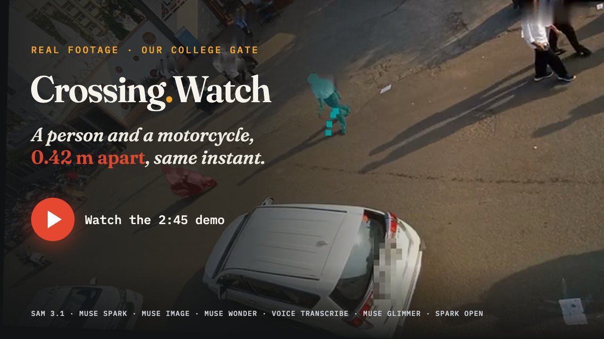
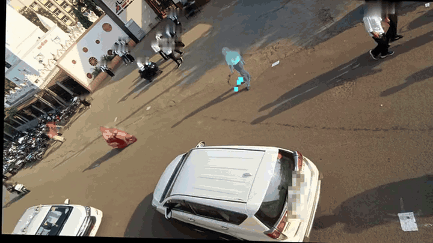
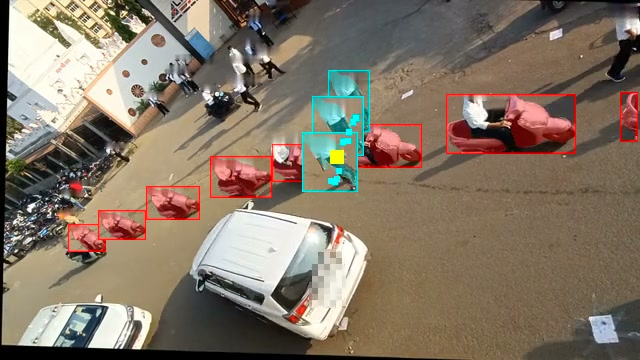
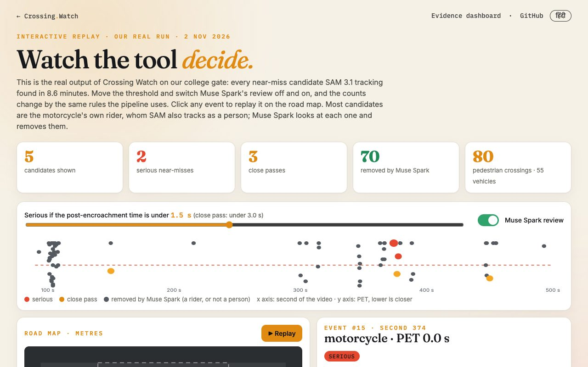
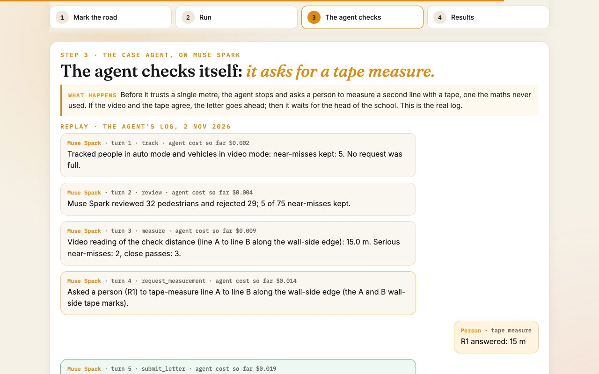
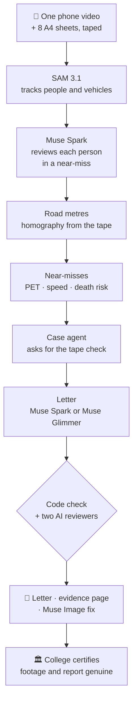

<div align="center">

<sub><b>META GLOBAL AI DEVELOPER HACKATHON 2026 · INDIE TRACK · SOLO ENTRY · BHOPAL, INDIA</b></sub>

# 🚸 Crossing Watch

### One phone video in. Proof the road authority can act on, out.

**75 alarms → 5 real near-misses** · closest **0.0 s, 0.42 m apart** · tape **15 m**, video **15.0 m** · our college **certified the report genuine**

<a href="https://youtu.be/XGxNWmFr_Ro"></a>

<b><a href="https://youtu.be/XGxNWmFr_Ro">▶ Watch the demo (2:45)</a></b> · <a href="https://crossingwatch.xyz/explorer/">Live Explorer</a> · <a href="https://crossingwatch.xyz/app/">App</a> · <a href="JUDGES.md">Judges: 5-minute map</a> · <a href="OPEN_WEIGHTS.md">Open weights</a> · <a href="https://crossingwatch.xyz/?lang=hi">हिंदी</a>

      


| Judging | Where to look |
|---|---|
| **Impact** | A real gate, real near-misses: closest **0.0 s, 0.42 m apart**. Our college certified the report genuine (3 Nov 2026). Any school can repeat it with the [Manual](https://crossingwatch.xyz/manual/), for about **$12** of SAM for our 8.6-minute video against about **C$5,000** an intersection for a funded near-miss study |
| **Meta AI tooling** | Seven Meta models, one job each ([table](#-seven-meta-models-each-doing-real-work)): **SAM 3.1** tracks and finds plates to hide; **Muse Spark** sets aside 66 of 75 alarms, runs the case agent and writes the letter; **Muse Image** draws the fix; **Muse Wonder** hears the horns; **Muse Voice Transcribe** finds speech to silence; **Muse Glimmer 30B** (LoRA-tuned by us) and **Muse Spark Open** run every reasoning step of the case on open weights |
| **Technical depth** | Tape 15 m vs video **15.0 m**, on a line the maths never used; drone ground truth **47 of 52**; [3 pre-registered blind-test wins](OPEN_WEIGHTS.md); **243** self-checks |
| **Demo** | The [2:45 video](https://youtu.be/XGxNWmFr_Ro); the [Live Explorer](https://crossingwatch.xyz/explorer/): switch Muse Spark's review off and on and watch 75 alarms become 5; the [live run's full log](provenance/live-run-2026-11-03/README.md) |
| **Open Weights** | Every reasoning step of our gate case on open weights, same 5 near-misses and 51 people ([run](provenance/open-gate-2026-11-04/README.md)); our LoRA-tuned Glimmer judge beats Muse Spark Open on Kaggle's free 2 x T4, **81 vs 49, p 0.006** ([one page](OPEN_WEIGHTS.md)) |
| **Agentic** | The case agent works 5 tools, stops to ask a person for a tape measure, and refuses the letter until video and tape agree ([log](provenance/gate-agent-2026-11-02/agent_log.jsonl), [replay](https://crossingwatch.xyz/app/#s3)) |
| **Creative** | Muse Image paints the zebra only inside the strip where people were measured crossing; Muse Wonder times the horns ([the fix](docs/story/09-fix.jpg)) |

**सड़क का ख़तरा · नाप के · सबूत के साथ**

<i>Everything here was built during the hackathon, from 28 Oct 2026, on Meta's models; the one ported piece is Meta's SAM mask decoder ([declarations](#declarations)). Built with Muse Spark Open.</i>

</div>
</div>

---

## 📑 Contents

[The problem](#-the-problem) · [Results](#-results-on-our-gate) · [Demo](#-demo) · [Try it in your browser](#-try-it-in-your-browser) · [Pipeline](#-pipeline) · [Seven Meta models](#-seven-meta-models-each-doing-real-work) · [How we know it's right](#-how-we-know-its-right) · [Screens](#-screens) · [Run it locally](#-run-it-locally) · [Privacy and cost](#-privacy-and-cost) · [Deep dive](#-deep-dive) · [Declarations](#declarations)

## 🚨 The problem

Outside schools and colleges everywhere, students cross between bikes, cars and buses every day. Road crashes kill about
**1.19 million people a year** and are the **leading cause of death for people aged 5 to 29** ([WHO, Global status report
on road safety 2023](https://www.who.int/publications/i/item/9789240086517)). Every school wants a speed breaker or a zebra
crossing at its gate, and only the road authority can build one. The authority asks for proof. **Crossing Watch turns one
phone video into that proof:** measured near-misses, blurred clips, and a letter the head of the college can sign.

## 📊 Results on our gate

<a href="docs/evidence/event1.mp4"></a>
<p><b>Real footage from our college gate, faces blurred.</b> A person (cyan) and a motorcycle (red) reach the same spot at the same instant: post-encroachment time <b>0.0 s</b>, motorcycle at <b>18.7 km/h</b>.</p>

<i>LNCT Excellence main gate, Bhopal (service road below NH 146) · Mon 2 Nov 2026, afternoon dismissal · one phone, 8.3 m up</i>

| Measured | Value |
|---|---|
| ⏱️ Video | **8.6 minutes** on a taped 15 m stretch |
| 🚶 Crossings | **80** tracked crossings; **51** people crossed on foot after Muse Spark set aside 28 riders and empty boxes, and 1 more was ruled out by eye |
| 🔎 Near-miss alarms | **75** candidates; Muse Spark set aside **66** (riders SAM saw as people, and empty boxes), **4** more were ruled out by eye; **5** remain (counted per alarm, where the row above counts people) |
| 🏍️ Moving vehicles | **55** · 85th-percentile speed **23.2 km/h** |
| 🔴 Serious near-misses (PET < 1.5 s) | **2**: 0.0 s at 18.7 km/h, 0.9 s at 18.3 km/h |
| 🟠 Close passes (1.5 to 3.0 s) | **3** |
| 📏 Tape check (never used to calibrate) | video **15.0 m** · tape **15 m** |
| 🏛️ The college | certified in writing (3 Nov 2026): filmed at its gate with permission, **the report is genuine** |
| 📄 The ask | a **painted zebra crossing** (no hump: college buses use this road) and **"College Zone 20 km/h"** signs |


<p><b>The 0.0 s near-miss in one picture.</b> SAM 3.1 tracks the motorcycle (red) and the person (cyan); one copy every 0.5 s, so wider spacing means faster. Faces and plates blurred.</p>

## 🎬 Demo

[Demo video (2:45)](https://youtu.be/XGxNWmFr_Ro), narrated by the author. It opens on our real near-miss (0.0 s), the author on camera, then the problem, a live run on our gate (its real log, sped up), a screen capture of the Live Explorer (Muse Spark's review off and on), our team measuring the check line with a tape, a screen capture of the real letter, the open-weights run records and the fix Muse Image drew on our real street. Its full log and commands: [provenance/live-run-2026-11-03](provenance/live-run-2026-11-03/README.md) (Muse Spark request resp_6ae9fb6e…). Video file: [release submission-2026-11-04](https://github.com/shaunmortal/crossing-watch/releases/tag/submission-2026-11-04).

## 🧪 Try it in your browser

No install, no key. Every page works in a browser; the App, Explorer and Manual have a हिंदी / English switch.

| Page | What you can do |
|---|---|
| 🛠️ **[App](https://crossingwatch.xyz/app/)** | Crossing Watch in 4 steps. Step 1 is the real road-marking tool: press **Try it with our gate** and the 4 corners of our 8 m × 7 m rectangle turn pixels into metres. Steps 2 and 3 replay our real run and the agent asking for a tape measure. |
| 🔎 **[Explorer](https://crossingwatch.xyz/explorer/)** | All 75 near-miss candidates from our gate. Move the threshold, switch Muse Spark's review off and on, replay any near-miss on the road map, play its blurred clip. |
| 📘 **[Manual](https://crossingwatch.xyz/manual/)** | 7 simple steps to measure the road outside your own school, with the tape plan and a printable field sheet. |
| 📄 **[Evidence dashboard](https://crossingwatch.xyz/evidence/)** | The report the tool made for our gate: clips, map, the Muse Image fix and the letter. |

<table>
<tr>
<td width="50%"><a href="https://crossingwatch.xyz/explorer/"></a><br><i><b>Explorer.</b> Watch the tool decide.</i></td>
<td width="50%"><a href="https://crossingwatch.xyz/app/"></a><br><i><b>App.</b> The agent stops and asks for a tape measure.</i></td>
</tr>
</table>

## 🧭 Pipeline



## 🧠 Seven Meta models, each doing real work

| Model | Job in Crossing Watch | Proof |
|---|---|---|
| **SAM 3.1** | Tracks people and vehicles, frame by frame | 47 of 52 near-misses vs drone truth; speed error 0.16 km/h mean ([DUT](TECHNICAL.md#end-to-end-against-ground-truth-dut)) |
| **Muse Spark** | Reviews each person in a near-miss, runs the case agent, writes the letter, judges it | flagged 24 of 24 planted lies ([bench](TECHNICAL.md#checking-the-checks)) |
| **Muse Image** | Draws the fix onto the real, blurred street, only where people crossed | [how](TECHNICAL.md#how-it-works) |
| **Muse Wonder** | Listens around each near-miss for horns, brakes and shouts | heard horns around 4 of the 5 near-misses at our gate |
| **Muse Voice Transcribe** | Finds human speech in each clip's sound so it can be silenced before publishing; the horn stays | no speech in our five clips, so every clip keeps its full road sound ([how](TECHNICAL.md#how-it-works)) |
| **Muse Glimmer 30B** · open weights | Wrote a full letter for our real gate on a free Kaggle GPU; our LoRA fine-tune judges letters; as the crop reviewer it made the same keep/remove call as Muse Spark on all 32 people at our gate ([review](provenance/glimmer-vision-review-2026-11-04/README.md)) | letter in **276 s, first try**; tuned judge **wins 3 pre-registered blind tests on planted errors** vs Muse Spark Open, Muse Spark (closed) still ahead overall ([one page](OPEN_WEIGHTS.md)); served on Fireworks, read our real letter 6 of 6 times, no unsupported claim ([record](provenance/glimmer-judge-lora-v6/live/gate-letter-judge.json)); runs free on Kaggle's 2 x T4 too and beats Spark Open again (81 vs 49, p 0.006, [score](provenance/glimmer-judge-lora-v6/kaggle/score.json)) |
| **Muse Spark Open** · open weights | Runs every reasoning step of our gate case on open weights (Spark Open review, agent and letter; our tuned Glimmer reviewer); SAM 3.1 and Muse Wonder replies reused from the hosted run | same 5 near-misses and 51 people as Muse Spark; letter passes every check first try ([run](provenance/open-gate-2026-11-04/README.md)) |

<details>
<summary><b>Every model's numbers in full</b></summary>

- **SAM 3.1** tracks people and vehicles. Against DUT's top-down drone ground truth: 47 of 52 conflicts found after Muse Spark's review (50 of 52 by geometry alone; crowd mode); speed error 0.16 km/h mean, 0.55 km/h at the 95th percentile (vehicle crowd mode). [DUT](TECHNICAL.md#end-to-end-against-ground-truth-dut), [30 Oct re-score](GATES.md#accuracy-fixes-merged-re-scored-at-0-fri-30-oct-2026)
- **Muse Spark** reviews each person in a near-miss, writes the fix and the letter, and runs the [case agent](TECHNICAL.md#case-agent-it-stops-to-ask-for-a-tape-measure), which stops to ask for a tape measure (on our gate: "Video 15.0 m, tape 15 m, 0% off: proven"). As judge it flagged 24 of 24 planted lies and only 1 of 8 clean letters (code alone: 4 of 24). [bench](TECHNICAL.md#checking-the-checks)
- **Muse Image** draws the fix only inside the strip where people were measured crossing; every other pixel stays the real, blurred street (the whole photo when no path was measured). Nothing measured. [how](TECHNICAL.md#how-it-works)
- **Muse Wonder** listens around each near-miss for horns, brakes and shouts. At our gate it heard horns around 4 of the 5 near-misses, each one timed on its card ("horn 1.0 s after") on the [evidence page](https://crossingwatch.xyz/evidence/).
- **Muse Glimmer 30B (open weights)**, self-hosted on Kaggle 2 x T4 from sha256-checked weights, wrote **a letter for our real gate in 276 s on the first try**, every number passing the code check ([letter](kaggle/glimmer-gate-letter.txt), [record](kaggle/glimmer-gate-provenance.json), [Kaggle log](kaggle/glimmer-gate-run-log.json); written from our first notes, which asked for a raised crossing; the letter for the authority is Muse Spark's: painted zebra, no hump). Our free LoRA fine-tune of Glimmer **beats Muse Spark Open in three pre-registered blind tests on planted errors** (p 0.005, 0.029, 0.0006; Muse Spark, closed, stays ahead overall); served on a Fireworks H200 it gives the same verdict on 1,499 of 1,501 rows, at about a quarter of Muse Spark's cost. Downloaded and run over Meta's 4-bit Glimmer on Kaggle's free 2 x T4, **it beats Muse Spark Open again** (81 vs 49, p 0.006; [score](provenance/glimmer-judge-lora-v6/kaggle/score.json)). [open weights, one page](OPEN_WEIGHTS.md)
- **Muse Spark Open (open weights)** on Fireworks wrote the synthetic sample's letter in one try, 55.5 s, and is the second AI reviewer of our crossing's letter. [record](provenance/spark-open-fireworks-sample.json)


</details>

## 🔬 How we know it's right

| | Check | Result | Proof |
|---|---|---|---|
| 🛰️ | Drone ground truth (DUT, top-down) | **47 of 52** near-misses found after Muse Spark's review; speed error **0.16 km/h** mean | [method](TECHNICAL.md#end-to-end-against-ground-truth-dut) |
| 📏 | Tape check on our gate, a line the maths never used | video **15.0 m**, tape **15 m**, 0% off | [the agent](TECHNICAL.md#case-agent-it-stops-to-ask-for-a-tape-measure) |
| 🧮 | Near-miss maths on public drone data (SinD) | speed error **0.24 km/h** mean | [validation](TECHNICAL.md#validation-on-ground-truth-trajectories) |
| 🕵️ | The letter: planted false numbers and claims | Muse Spark flagged **24 of 24** (**21 of 23** on the public bench you can re-run at $0); code checks every number | [bench](TECHNICAL.md#checking-the-checks) |
| 🔓 | Open weights | tuned Glimmer judge wins **3** pre-registered blind tests on planted errors over Muse Spark Open (Muse Spark, closed, stays ahead overall); Muse Spark Open read our letter **6 of 6** times, no unsupported claim | [one page](OPEN_WEIGHTS.md) |
| 📋 | Pass marks written before the runs | **G1 to G4 passed**: news CCTV, our gate's tape (15.0 m vs 15 m), DUT drone truth, our footage end to end | [GATES](GATES.md#verdict-now) |
| ✅ | Self-checks | **243** self-checks, `python3 test_cw.py`, offline, in under a minute | [every claim](TECHNICAL.md#check-it-yourself) |

## 📸 Screens

<table>
<tr>
<td width="33%"><br><i><b>The gate.</b> Real photo, the road we measured.</i></td>
<td width="33%"><a href="docs/story/06-letter.jpg"></a><br><i><b>The letter.</b> To the road authority, every number code-checked; its "80 pedestrian crossings" counts tracked crossings before Muse Spark's review (51 people crossed on foot).</i></td>
<td width="33%"><br><i><b>The fix, drawn by Muse Image.</b> What the letter asks for. AI-generated: the people are not real.</i></td>
</tr>
</table>

## 🚀 Run it locally

Needs Python 3.11+ and ffmpeg; no key, no video. With `MODEL_API_KEY` or `LETTER_MODEL_URL` set, the sample also gets the fix and the letter.
```
python3 test_cw.py                        # self-checks, under a minute
python3 pack.py sample sample/site.json   # the synthetic sample (made-up tracks) -> sample/index.html
open sample/index.html                    # macOS; elsewhere open the file in a browser
```

## 🔒 Privacy and cost

- 🙈 Every tracked face is blurred and every number plate pixelated on every published frame: SAM 3.1 finds the plates at full resolution, so cars and bikes still look like cars and bikes. The raw video stays on the laptop that ran it, apart from the calls to Meta's API, in Standard mode (not used to train models).
- 💸 About **$12** of SAM for our 8.6-minute gate video at Meta's list prices, plus about **$0.02** for the agent, against about **C$5,000** an intersection for a funded near-miss study ([Scale](TECHNICAL.md#scale)). `--budget` is a hard cap.
- 🔑 Keys stay in `.env`, never in the repo.
- 🏫 Filmed with the college's permission; on 3 Nov 2026 the college certified the report genuine.

## 📚 Deep dive

Everything else is in **[TECHNICAL.md](TECHNICAL.md)**:

- **[Open weights, one page](OPEN_WEIGHTS.md)**: Glimmer's gate letter, our LoRA judge and its three blind-test wins on planted errors over Muse Spark Open (Muse Spark still ahead)
- **[Case agent](TECHNICAL.md#case-agent-it-stops-to-ask-for-a-tape-measure)**: the agent that stops to ask for a tape measure
- **[Check it yourself](TECHNICAL.md#check-it-yourself)**: every claim, the command that re-checks it, and whether a judge can do it for $0
- **[Files](TECHNICAL.md#files)**: what each script does
- **[How it works](TECHNICAL.md#how-it-works)**: every step: the model or method and its file
- **[Run](TECHNICAL.md#run)**: the commands, notes and sign-off, the Hindi copy, what gets published, Standard mode, caching
- **[Checking the checks](TECHNICAL.md#checking-the-checks)**: the planted-lies bench and the blind check
- **[Validation on ground-truth trajectories](TECHNICAL.md#validation-on-ground-truth-trajectories)**: SinD, the phone-angle simulation and DUT end to end
- **[Scale](TECHNICAL.md#scale)**: cost against a funded near-miss study
- **[Limits, stated](TECHNICAL.md#limits-stated)**: what the tool cannot do
- **[Related work](TECHNICAL.md#related-work)**: near-miss studies in India and elsewhere
- **[Sources](TECHNICAL.md#sources)**: every paper, standard and order we cite

## Declarations

Solo entry by Ayush Kumar, built with Claude Code as a coding assistant. All work here was done during the hackathon,
from 28 Oct 2026; the one ported piece is the mask decoder below. The gate letter's run
(`kaggle/glimmer-gate.ipynb`) was on the author's own Kaggle account.

- **Licences.** `masks.py` ports the one_bit mask decoder from Meta's meta-sam-parser (`_mask_codec.py`, Copyright (c)
  Meta Platforms, Inc. and affiliates) under its SAM License, in `LICENSES/SAM-License.txt`; all other code and the docs
  are MIT (`LICENSE`). The footage, photos and college documents in `docs/` are not under MIT: they show real people
  (faces and plates hidden) and are shared only to show this work. The letter's check-then-retry, reject-with-notes and one-tool-per-turn agent loop follow the shape of
  Meta's legal-agent workshop (github.com/meta-models/legal-agent-workshop); no code was copied from it.
- **What runs.** Python standard library only (the optional stabiliser, `stabilize.py`, also needs OpenCV and NumPy), plus ffmpeg as a command-line tool (a GPL build with libx264, not
  bundled) and Chrome or any Chromium for the demo's hero shot (`video/split.py`). Inside the Kaggle notebook:
  llama.cpp `b11976` (MIT), huggingface_hub (Apache-2.0) and the Muse Glimmer 30B GGUF weights (Apache-2.0, Hugging
  Face revision `b44f1072`). Built with Muse Spark Open: its open weights are used as served by Fireworks under Meta's Muse Model License, and
  our Glimmer judge adapter is trained partly on letters Spark Open wrote, so it follows that licence too. Models run as
  services: the Meta Model API, Fireworks for Muse Spark Open and our Glimmer LoRA judge (trained and served there),
  Kaggle's 2 x T4 for Glimmer's letter. The website (`docs/`) loads GSAP 3.12.5 with ScrollTrigger and Lenis 1.1.13
  from public CDNs, and Google Fonts, each under its own licence.
- **Datasets, none included.** SinD (github.com/SOTIF-AVLab/SinD; non-commercial, its public sample used only for
  validation; Xu Y. et al., IEEE ITSC 2022, doi:10.1109/ITSC55140.2022.9921959, v1). DUT
  (github.com/dongfang-steven-yang/vci-dataset-dut; published openly by its authors with a request to cite, which we do;
  it has no licence file, so we redistribute none of it, only our scores; Yang D. et al., IEEE IV 2019, arXiv:1902.00487). Two YouTube clips used only for local testing: the schoolchildren CCTV clip
  (https://youtu.be/9YqdnG5Jxnw) and the Indian time-lapse (https://youtu.be/_l99w_CKwCU).
- **Commit ids.** Ids quoted in files before 4 Nov 2026 are from before the one history cleanup; COMMIT_IDS.md maps each to its id in this repository.
- **AI assistance.** Code and docs were written with an AI coding assistant, and the reviews named in `GATES.md` were
  AI-assisted; every model call in the product is to a Meta model. The demo video's voice is the author's own, recorded on
  his laptop; its AI pictures are labelled on screen.
